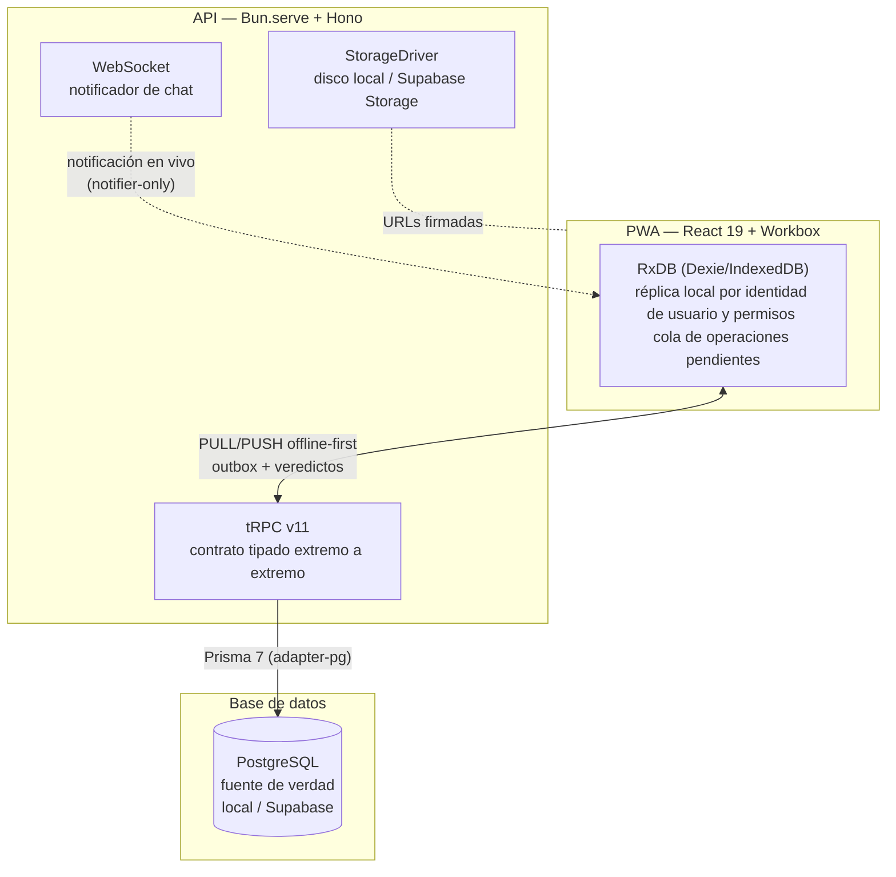
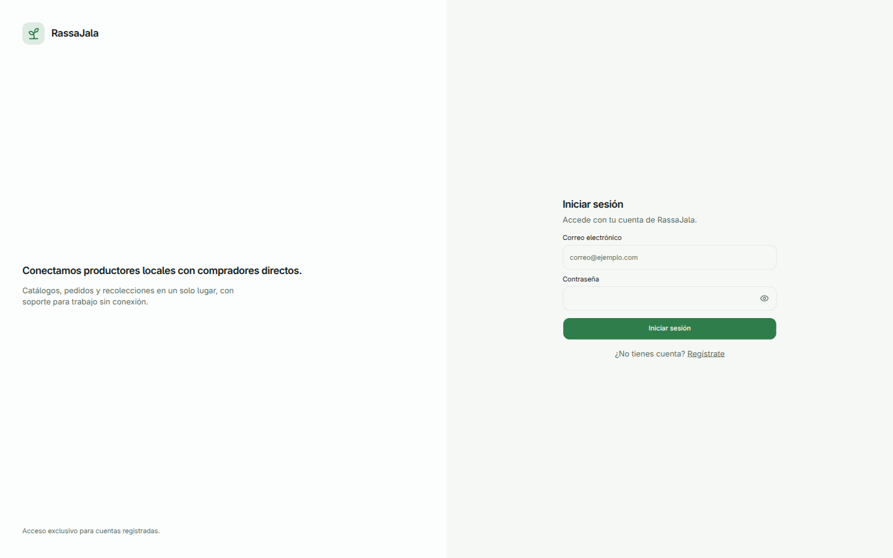
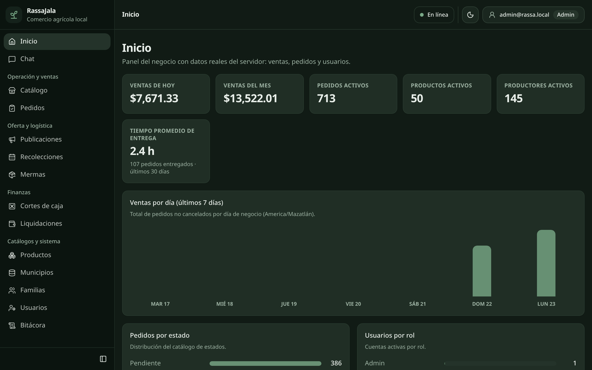
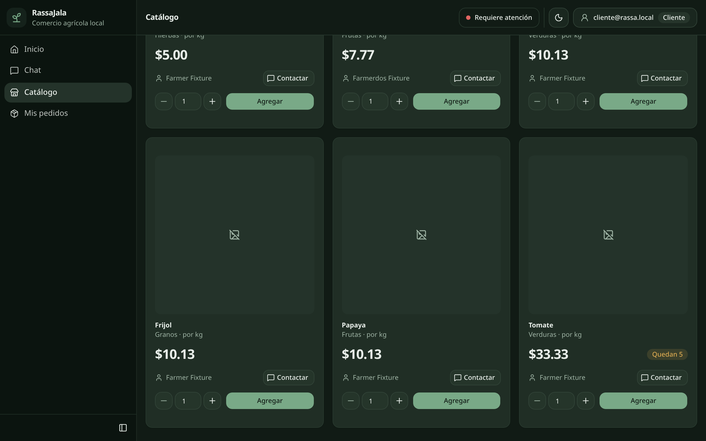
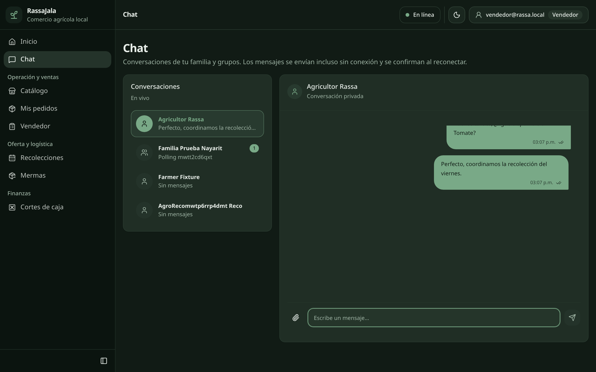
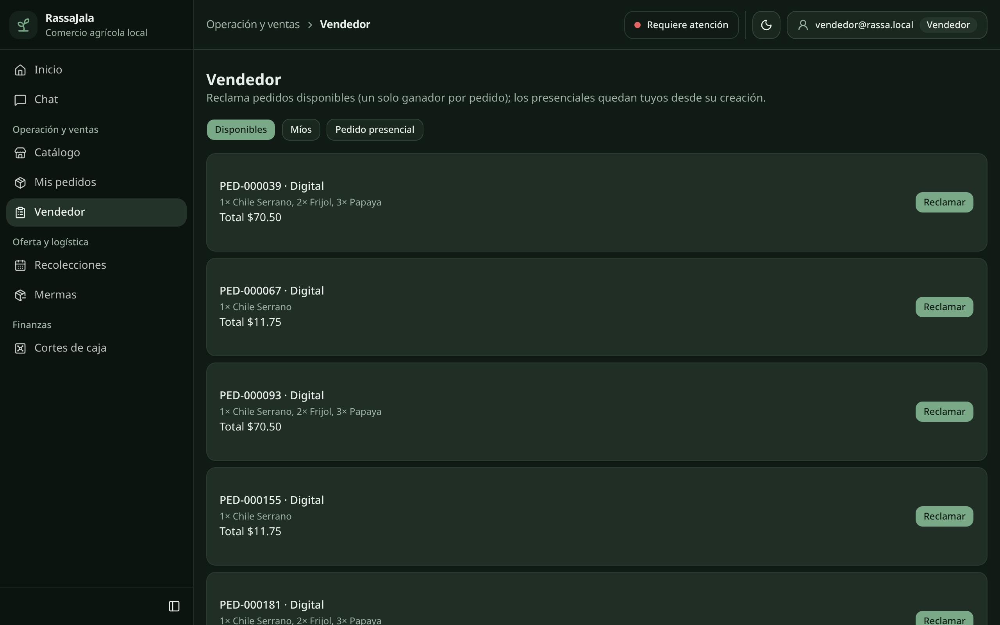
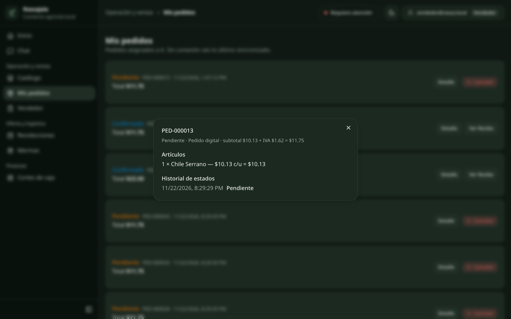

# RassaJala 🌱

**Plataforma de comercio agrícola local con arquitectura Offline-First.**

RassaJala es una Progressive Web Application (PWA) diseñada para conectar productores
agrícolas con compradores directos, facilitando la publicación semanal de productos,
la gestión de pedidos, pagos, recolecciones y administración de operaciones comerciales.

La aplicación está diseñada para funcionar **online y offline**, manteniendo información
local y sincronizándola con PostgreSQL cuando existe conectividad.

## Características principales

- Gestión de usuarios, roles y familias.
- Administración de productos y catálogos.
- Publicaciones agrícolas semanales.
- Gestión y seguimiento de pedidos.
- Pagos, recibos y cortes de caja.
- Administración de recolecciones.
- Liquidaciones y control de mermas.
- Comunicación entre usuarios.
- Persistencia local y sincronización.
- PWA instalable y adaptable a dispositivos móviles.

## Arquitectura

El proyecto utiliza una arquitectura modular Offline-First de tres capas:



El backend centraliza las validaciones, las reglas de negocio, la autorización y
la sincronización.

## Offline-First

La aplicación permite consultar información previamente sincronizada y realizar
las operaciones locales que están expresamente habilitadas (catálogos, carrito,
borradores de publicación, chat).

Los cambios pendientes se sincronizan cuando vuelve a estar disponible el
backend. Las operaciones financieras y las que afectan al inventario requieren
**validación y confirmación central**: el dinero y el stock nunca se escriben
como documento crudo del cliente.

Mecánica:

- **Outbox transaccional**: cada mutación escribe su fila de cambio en la misma
  transacción que el efecto.
- **PUSH idempotente** con veredicto por operación (`aplicada | conflicto |
rechazada`) registrado por el servidor.
- **PULL con checkpoint monotónico** y regla de ventana de brechas: ninguna
  actualización se pierde por carreras de commit.

## Capturas de pantalla

Selección de capturas de la aplicación (todas con datos de prueba):

<div align="center">
  <table>
    <tr>
      <td width="50%"></td>
      <td width="50%"></td>
    </tr>
    <tr>
      <td width="50%"></td>
      <td width="50%"></td>
    </tr>
    <tr>
      <td width="50%"></td>
      <td width="50%"></td>
    </tr>
  </table>
</div>

## Estructura del monorepo

```text
rassa-jala/
├── apps/
│   ├── web/            # PWA React 19 + TanStack + RxDB + Workbox
│   └── server/         # API Bun.serve + Hono + tRPC + WebSocket + uploads multipart
├── packages/
│   ├── api/            # Contratos tRPC compartidos (routers, money, auth)
│   ├── db/             # Prisma 7: schemas por dominio, migraciones, seed, scripts
│   ├── ui/             # Primitivas shadcn/ui compartidas (Base UI + Tailwind 4)
│   └── config/         # tsconfig base compartido
├── docs/               # Arquitectura, modelo de datos, sincronización, capturas
├── netlify.toml        # Deploy de la PWA
└── package.json        # Workspaces + scripts raíz
```

## Requisitos

- **Bun 1.4+** (runtime, gestor de paquetes y workspaces)
- **PostgreSQL** local para desarrollo y Supabase PostgreSQL para el entorno de producción.

## Configuración de entorno

Cada app declara su esquema en `.env.schema` (varlock) y un `.env.example` con
valores ficticios:

| Archivo                    | Variables clave                                                                                                      |
| -------------------------- | -------------------------------------------------------------------------------------------------------------------- |
| `apps/server/.env.example` | `DATABASE_URL`, `CORS_ORIGIN`, `JWT_ACCESS_SECRET`/`JWT_REFRESH_SECRET`, `STORAGE_DRIVER`, `SUPABASE_*` (opcionales) |
| `packages/db/.env.example` | `DATABASE_URL` (Prisma), `SUPABASE_DATABASE_URL` (opcional, script de sincronización)                                |
| `apps/web/.env.example`    | `VITE_SERVER_URL` (URL del API que consume la PWA)                                                                   |

## Desarrollo

```bash
bun install                # instala + codegen varlock
bun run db:generate        # genera el cliente Prisma
bun run db:push            # aplica el esquema a tu PostgreSQL
bun run db:seed            # datos semilla (catálogos, usuarios de prueba)
bun run dev                # API en :3000 + web en :3001
# o por separado:
bun run dev:server
bun run dev:web
```

> Variante Supabase: `dev:supabase` / `dev:server:supabase` arrancan el stack
> contra el entorno de Supabase usando el env-file
> `apps/server/.env.supabase.local` (ver `.env.schema`).
> Sin ese archivo, usa `dev:server` con PostgreSQL local.

## Pruebas

```bash
bun run test    # bootstrap de BD e2e aislada + batería completa (bun test)
```

- Cobertura e2e por módulo (`apps/web/e2e/`: auth, catálogos, pedidos, pagos,
  chat, sincronización, roles, logs, etc.) más unitarias
  (`packages/api/src/money.test.ts`, RxDB push/rewind, etc.).
- Re-ejecutables: la batería completa corre dos veces seguidas sin limpiar
  estado (fixtures auto-contenidas).
- `bootstrap-e2e.ts` crea una BD e2e aislada (`rassa_jala_db_e2e`) y su
  `.env.e2e` (gitignored).
- Scripts auxiliares: `apps/web/scripts/rxdb-check.ts` y `slice-e2e.ts`
  (requieren servidor y web corriendo).

## Contexto académico

RassaJala es un proyecto desarrollado como parte de la asignatura
**IDGS102 — Aplicaciones Web Progresivas**, correspondiente al periodo
septiembre–diciembre de 2026.

El proyecto consiste en el desarrollo de una nueva Progressive Web Application
(PWA), con el objetivo de conservar y completar su funcionalidad de negocio,
incorporando una arquitectura moderna con soporte Offline-First.

La implementación se desarrolló de manera independiente, siguiendo los
requisitos académicos de funcionamiento Online/Offline, persistencia relacional
mediante PostgreSQL en Supabase y documentación técnica.

## Créditos y antecedentes

RassaJala es una plataforma cuyo desarrollo original surgió de un proyecto de colaboración estudiantil.

Esta nueva implementación constituye una reconstrucción técnica independiente,
tomando como referencia las funcionalidades y reglas de negocio del sistema preexistente.

**Proyecto original:**

- [Organización RassaJala](https://github.com/RassaJala)
- [Frontend original](https://github.com/RassaJala/rassa_front)
- [Backend original](https://github.com/RassaJala/rassa_back)

Se reconoce la participación de los colaboradores del proyecto original en el desarrollo de sus respectivas implementaciones.

## Autoría y derechos de uso

El código y los materiales originales creados específicamente para esta nueva
implementación corresponden a sus respectivos autores y titulares de derechos.

Este repositorio se publica con fines de documentación, demostración y evidencia
académica y profesional. No se concede mediante esta publicación una licencia general
de código abierto ni autorización para reutilizar, modificar, distribuir o explotar
comercialmente los materiales sobre los cuales los respectivos titulares conservan derechos.

El nombre, identidad visual, marca, documentación y demás materiales preexistentes
de RassaJala no se reivindican como propiedad del desarrollador de esta nueva
implementación y permanecen sujetos a los derechos de sus respectivos titulares.

Las contribuciones de terceros y las dependencias utilizadas conservan sus respectivas
atribuciones y condiciones de uso.
