# Database Audit — Legacy `rassa_back` (RassaJala)

Schema audit of the legacy backend's persistence layer, as reference input for the new
independent app (Prisma + Supabase Postgres). Findings are separated into **Confirmed**
(verifiable repo evidence, cited) and **Inference** (labeled, with evidence). Open
questions are collected at the end; nothing is invented to fill them.

## Quick path

1. [Source of truth](#1-source-of-truth) — which artifact defines the schema and what drift exists.
2. [Entity inventory](#2-entity-inventory) — every table with fields, types, nullability, defaults, choices.
3. [Keys & relations](#3-keys--relations) and the [ER diagram](#4-relations-diagram).
4. [Migrations inventory](#5-migrations-inventory), [Enumerations](#6-enumerations), [Integrity & lifecycle](#7-data-integrity--lifecycle-rules).
5. Finish with [Gaps](#9-gaps-and-open-questions).

---

## 1. Source of truth

**Status: Confirmed.**

Three schema artifacts exist:

| Artifact                                      | Role                                                                                                                                | Evidence                                                                                                                                                 |
| --------------------------------------------- | ----------------------------------------------------------------------------------------------------------------------------------- | -------------------------------------------------------------------------------------------------------------------------------------------------------- |
| `legacy/rassa_back/rassa/models.py`           | Current domain models (34 models, Spanish snake_case column names preserved for compatibility)                                      | `models.py:1-13` (module docstring states it maps the original `rassa_jala.sql` tables)                                                                  |
| `legacy/rassa_back/rassa/migrations/`         | 31 migration files (0001 → 0027, includes one squash and four merges) — **the authoritative history actually applied to databases** | Applied by `manage.py migrate`; CI enforces `makemigrations --check` (`legacy/rassa_back/.github/workflows/ci.yml`, "Check for missing migrations" step) |
| `legacy/rassa_back/db/archive/rassa_jala.sql` | **Archived** original hand-written schema (v3.1, 32 tables) + seeders; superseded by migrations                                     | File header: "Migración unificada: Esquema + Seeders"; placed under `db/archive/`                                                                        |

**Treatment for this audit: models.py as read through the migration chain is authoritative.**
The SQL archive documents the original intent and is used here to flag semantic drift
(§1.1, §7). Drift between models and migrations was checked by reading the full migration
chain against `models.py`; no model-state mismatch was found in that static review, and the
project enforces this continuously with `makemigrations --check --dry-run` (CI) plus
`legacy/rassa_back/rassa/tests/test_migrations.py` (graph consistency, squash-replaces
assertions, data-migration idempotency).

### 1.1 Models vs. SQL archive drift (Confirmed)

The `rassa_jala.sql` archive no longer matches the models. Differences that matter to a
reimplementation:

1. **Authentication columns/tables**: SQL `usuario.contrasenia VARCHAR(255) NOT NULL` was
   dropped (migration 0002); authentication moved to Django's `auth_user` via
   `Usuario.fk_user` OneToOne (`legacy/rassa_back/rassa/models.py:193-200`).
2. **Generated columns removed**: SQL declared `pedido_cabecera.total`,
   `detalle_pedido.importe`, `corte.diferencia`, `liquidacion.monto_liquidar` as
   `GENERATED ALWAYS AS (...) STORED` (`db/archive/rassa_jala.sql:244,262,327,494`);
   the ORM replaces them with plain columns computed in `save()`
   (`models.py:442-444,466-469,615-620`, `liquidacion` has no `save()` override —
   `monto_liquidar` is written explicitly by the liquidación service,
   `legacy/rassa_back/rassa/blueprints/liquidaciones/views.py:140-149`).
3. **CHECK constraints not migrated** (see §7): SQL had CHECKs on `persona.sexo`,
   `publicacion_semanal.semana` (1–52) and `estado` enums, `producto_semanal.stock/precio`,
   `detalle_pedido.cantidad`, `pago.monto`, `merma.cantidad`, `limite_cliente.monto`,
   `corte.estado`, `documento.tipo_documento`, `liquidacion.estado`. Only the
   `semana` range check survives as a Django `CheckConstraint` (`models.py:354-358`);
   everything else became application-level (serializer) validation.
4. **Named indexes not migrated**: SQL's `idx_*` section
   (`db/archive/rassa_jala.sql:508-580`) has no counterpart in migrations except
   `corte.fecha` (`db_index=True`, `models.py:582`, migration 0020). Django still
   auto-indexes FKs and unique columns.
5. **Nullability relaxations**: `familia.fk_jefe_familia` NOT NULL → nullable SET_NULL;
   `recibo.fk_pago`/`fk_pedido`, `mensaje.fk_emisor`, `logs.fk_usuario`,
   `historial_estado_pedido.fk_cambiado_por`, `pago.fk_pedido` all NOT NULL → nullable
   (migrations 0003, 0005, 0006; §5).
6. **`familia_usuario.fk_usuario` uniqueness relaxed**: SQL had
   `fk_usuario INT NOT NULL UNIQUE` (one membership row per user ever)
   (`db/archive/rassa_jala.sql:149`); Django has a plain FK — multiple membership rows per
   user are representable, and the "one active family" rule is enforced only in serializers
   (`legacy/rassa_back/rassa/blueprints/familias/serializers.py:57-88`).
7. **Post-migration additions absent from SQL**: `usuario.fk_user`, `producto`
   (descripcion/precio/stock/fk_unidad/imagen), `municipio`/`localidad.estado`,
   `unidad.nombre`/`abreviatura`, `pago.folio` + nullable `fk_pedido`,
   `conversacion.fk_familia`/`nombre_override`, `integrantes.rol`,
   `producto_imagen.orden`/`drive_file_id`/`eliminar_pendiente`,
   `corte.fk_vendedor`/`fecha`, `liquidacion.tasa_comision`, `merma.fk_pedido`,
   `mensaje.editado`, and the two new tables `historial_estado_recoleccion` and
   `liquidacion_venta` (migrations 0004–0027; SQL archive has 32 tables, the ORM has 34).

---

## 2. Entity inventory

**Status: Confirmed** — every field below is read from `legacy/rassa_back/rassa/models.py`
with line citations. Conventions: PK = AutoField (`BigAutoField` default is only for
auto-added fields; these PKs are explicit `AutoField` → integer). `estado` Boolean
columns are soft-delete flags unless the entity has a char `estado` lifecycle.
`creado_en` is `DateTimeField(auto_now_add=True)` everywhere it appears.

### Business tables (34, via explicit `db_table`)

#### `roles` — Rol (`models.py:26-40`)

| Column      | Type         | Null | Default      | Notes       |
| ----------- | ------------ | ---- | ------------ | ----------- |
| id_rol      | AutoField PK | —    | —            |             |
| nombre_rol  | varchar(50)  | no   | —            | unique      |
| descripcion | varchar(300) | no   | —            |             |
| creado_en   | timestamptz  | no   | auto_now_add |             |
| estado      | bool         | no   | true         | soft delete |

#### `categoria_producto` — CategoriaProducto (`models.py:43-57`)

id_categoria PK; nombre varchar(50); descripcion varchar(300); creado_en; estado (soft delete).

#### `unidad` — Unidad (`models.py:60-75`)

| Column      | Type         | Null    | Default                                                                                      |
| ----------- | ------------ | ------- | -------------------------------------------------------------------------------------------- |
| id_unidad   | PK           | —       | —                                                                                            |
| tipo        | varchar(50)  | **yes** | — (legacy column kept in sync with `nombre` by serializer, `catalogos_serializers.py:78-91`) |
| nombre      | varchar(100) | **yes** | —                                                                                            |
| abreviatura | varchar(20)  | **yes** | —                                                                                            |
| creado_en   | timestamptz  | no      | auto                                                                                         |
| estado      | bool         | no      | true                                                                                         |

#### `estado_pedido` — EstadoPedido (`models.py:78-91`)

id_estado PK; tipo_estado varchar(50) unique; descripcion varchar(300); creado_en.
Data rows seeded: pendiente, confirmado, en_preparacion, listo_para_retirar, entregado, cancelado, **activo** (legacy, unused — `seed_rassa_data.py:316-355`).

#### `decision_merma` — DecisionMerma (`models.py:94-107`)

id_decision PK; decision varchar(50); creado_en; estado (soft delete).
Seed: Donar, Desechar, "Vender más barato", Compostar (`seed_rassa_data.py:358-367`).

#### `municipio` — Municipio (`models.py:115-127`)

id_municipio PK; nombre varchar(100); estado (soft delete, added by squash 0007). **No `creado_en`.**

#### `localidad` — Localidad (`models.py:130-143`)

id_localidad PK; nombre varchar(150); fk_municipio FK → municipio **CASCADE**; estado (soft delete). **No `creado_en`.**

#### `persona` — Persona (`models.py:151-182`)

| Column           | Type           | Null    | Default | Notes                                      |
| ---------------- | -------------- | ------- | ------- | ------------------------------------------ |
| id_persona       | PK             | —       | —       |                                            |
| nombre           | varchar(100)   | no      | —       |                                            |
| apellido_paterno | varchar(100)   | no      | —       |                                            |
| apellido_materno | varchar(100)   | **yes** | —       |                                            |
| fecha_nacimiento | date           | no      | —       |                                            |
| sexo             | varchar(1)     | no      | —       | choices M/F/O (§6); SQL CHECK not migrated |
| domicilio        | varchar(300)   | no      | —       |                                            |
| fk_localidad     | FK → localidad | **yes** | —       | **SET_NULL**                               |
| creado_en        | timestamptz    | no      | auto    |                                            |
| estado           | bool           | no      | true    |                                            |

#### `usuario` — Usuario (`models.py:185-228`)

| Column     | Type                   | Null    | Default | Notes                                                          |
| ---------- | ---------------------- | ------- | ------- | -------------------------------------------------------------- |
| id_usuario | PK                     | —       | —       |                                                                |
| fk_user    | OneToOne → `auth_user` | **yes** | —       | **SET_NULL**, related_name `usuario`                           |
| fk_persona | OneToOne → persona     | no      | —       | **CASCADE**                                                    |
| telefono   | varchar(15)            | no      | —       |                                                                |
| correo     | varchar(150)           | no      | —       | unique                                                         |
| fk_rol     | FK → roles             | no      | —       | **PROTECT**                                                    |
| creado_en  | timestamptz            | no      | auto    |                                                                |
| estado     | bool                   | no      | true    | deactivation flag (not checked at login — backend audit §10.1) |

#### `familia` — Familia (`models.py:236-253`)

id_familia PK; fk_jefe_familia FK → usuario **SET_NULL**, null; nombre_familia varchar(100);
detalle_familia varchar(300) null; creado_en; estado (soft delete).

#### `familia_usuario` — FamiliaUsuario (`models.py:256-270`)

id_familia_usuario PK; fk_usuario FK → usuario **CASCADE**; fk_familia FK → familia
**CASCADE**; estado (membership active flag); creado_en. No unique on fk_usuario (see §1.1.6).

#### `limite_cliente` — LimiteCliente (`models.py:278-291`)

id_limite PK; fk_usuario **OneToOne → usuario CASCADE**; monto decimal(10,2); creado_en.
No DB CHECK on `monto ≥ 0` (SQL had one; app relies on absence of write endpoints).

#### `producto` — Producto (`models.py:299-319`)

id_producto PK; nombre_producto varchar(150); descripcion text (blank, default "");
fk_categoria FK → categoria_producto **PROTECT**; fk_unidad FK → unidad **PROTECT**, null;
precio decimal(10,2) default 0; stock positive int default 0; es_perecedero bool default
false; imagen text null (legacy denormalized principal-image URL, kept in sync by
`legacy/rassa_back/rassa/productos_views.py:193-210,320-333`); estado (soft delete); creado_en.

#### `publicacion_semanal` — PublicacionSemanal (`models.py:327-366`)

| Column            | Type         | Null    | Default    | Notes                                             |
| ----------------- | ------------ | ------- | ---------- | ------------------------------------------------- |
| id_publicacion    | PK           | —       | —          |                                                   |
| fk_agricultor     | FK → usuario | **yes** | —          | SET_NULL                                          |
| fecha_publicacion | date         | no      | —          | next Monday on create                             |
| semana            | positive int | no      | —          | CheckConstraint 1–52 (`check_semana_range`)       |
| estado            | varchar(20)  | no      | "borrador" | choices borrador/publicado/cerrado/cancelado (§6) |
| creado_en         | timestamptz  | no      | auto       |                                                   |

Constraints: `unique_agricultor_semana` (fk_agricultor, semana).

#### `producto_semanal` — ProductoSemanal (`models.py:369-395`)

id_producto_semanal PK; fk_publicacion FK → publicacion_semanal **CASCADE**; fk_producto
FK → producto **PROTECT**; fk_unidad FK → unidad **PROTECT**; stock positive int;
precio decimal(10,2); foto text null (URL string); estado varchar(20) default "activo"
(choices activo/inactivo — soft-delete-like); creado_en. **No DB CHECK on stock/precio**
(SQL had them; serializer-level only).

#### `pedido_cabecera` — PedidoCabecera (`models.py:403-444`)

| Column           | Type               | Null    | Default | Notes                                                        |
| ---------------- | ------------------ | ------- | ------- | ------------------------------------------------------------ |
| id_pedido        | PK                 | —       | —       |                                                              |
| fk_cliente       | FK → usuario       | **yes** | —       | SET_NULL, related_name `pedidos_como_cliente`                |
| fk_estado        | FK → estado_pedido | no      | 1       | PROTECT                                                      |
| subtotal         | decimal(10,2)      | no      | —       |                                                              |
| iva              | decimal(10,2)      | no      | —       | 21 % of subtotal at creation                                 |
| fk_vendedor      | FK → usuario       | **yes** | —       | SET_NULL, related_name `pedidos_como_vendedor`               |
| fecha_expiracion | timestamptz        | **yes** | —       | never written by the create flow                             |
| total            | decimal(10,2)      | no      | —       | recomputed as subtotal+iva in `save()` (`models.py:442-444`) |
| creado_en        | timestamptz        | no      | auto    |                                                              |

#### `detalle_pedido` — DetallePedido (`models.py:447-469`)

id_detalle PK; fk_pedido FK → pedido_cabecera **CASCADE**; fk_producto_semanal FK →
producto_semanal **CASCADE**; nombre_producto varchar(150) (snapshot of name at purchase);
precio_unitario decimal(10,2); cantidad positive int; importe decimal(10,2) (computed in
`save()` only when None, `models.py:466-469`); creado_en.

#### `tipo_pago` — TipoPago (`models.py:477-489`)

id_tipo_pago PK; nombre varchar(30) unique; creado_en. Seed: Efectivo, Transferencia, Depósito.

#### `pago` — Pago (`models.py:492-530`)

| Column     | Type                 | Null    | Default | Notes                                                                                                    |
| ---------- | -------------------- | ------- | ------- | -------------------------------------------------------------------------------------------------------- |
| id_pago    | PK                   | —       | —       |                                                                                                          |
| fk_pedido  | FK → pedido_cabecera | **yes** | —       | SET_NULL; NULL = liquidación payout                                                                      |
| fk_tipo    | FK → tipo_pago       | no      | —       | PROTECT                                                                                                  |
| monto      | decimal(10,2)        | no      | —       |                                                                                                          |
| referencia | varchar(100)         | **yes** | —       |                                                                                                          |
| folio      | varchar(50)          | no      | ""      | **unique**; generated `REC-YYYYMMDD-###` in `save()` under `pg_advisory_xact_lock` (`models.py:515-530`) |
| creado_en  | timestamptz          | no      | auto    |                                                                                                          |

Constraint: `unique_pago_per_pedido` on `fk_pedido` with **nulls_distinct=True**
(multiple NULL fk_pedido rows allowed — requires PostgreSQL ≥ 15, `legacy/rassa_back/rassa/checks.py:5-33`).

#### `merma` — Merma (`models.py:538-563`)

id_merma PK; fk_producto_semanal FK → producto_semanal **SET_NULL**, null; cantidad
positive int; motivo varchar(300); comentarios text null; fk_decision FK → decision_merma
**PROTECT**; fk_pedido FK → pedido_cabecera **PROTECT**, related_name `mermas` (added by
migration 0027); creado_en; estado (soft delete).

#### `corte` — Corte (`models.py:571-620`)

| Column        | Type          | Null    | Default              | Notes                                                                   |
| ------------- | ------------- | ------- | -------------------- | ----------------------------------------------------------------------- |
| id_corte      | PK            | —       | —                    |                                                                         |
| fk_vendedor   | FK → usuario  | **yes** | —                    | SET_NULL, related_name `cortes`                                         |
| fecha         | date          | no      | `timezone.localdate` | **db_index=True**                                                       |
| monto_real    | decimal(10,2) | no      | —                    |                                                                         |
| monto_teorico | decimal(10,2) | no      | —                    | snapshot at creation                                                    |
| diferencia    | decimal(10,2) | no      | —                    | snapshot `monto_real − monto_teorico` at creation (`models.py:615-620`) |
| estado        | varchar(20)   | no      | "abierto"            | choices abierto/cerrado/cuadrado                                        |
| creado_en     | timestamptz   | no      | auto                 |                                                                         |

Constraint: `unique_corte_vendedor_fecha` **partial** (`fk_vendedor IS NOT NULL`) — orphan
cortes (deleted vendedor) may share a date (`models.py:600-610`).

#### `logs` — Log (`models.py:628-644`; the `logs` app's own `models.py` is empty)

id_log PK; fk_usuario FK → usuario **SET_NULL**, null; descripcion text; ip
GenericIPAddressField; dispositivo varchar(200); creado_en; estado.

#### `conversacion` — Conversacion (`models.py:652-676`)

id_conversacion PK; nombre varchar(100) null; tipo bool default false (**false = privada,
true = grupal**); fk_familia FK → familia **SET_NULL**, null; nombre_override bool default
false; creado_en; estado (soft delete).
Constraint: `unique_active_family_conversation` **partial** (`estado = true AND fk_familia IS NOT NULL`).

#### `integrantes` — Integrante (`models.py:679-702`)

id_miembro PK; fk_usuario FK → usuario **CASCADE**; fk_conversacion FK → conversacion
**CASCADE**; creado_en; estado (membership active flag); rol varchar(10) default "miembro"
(choices miembro/admin).
Constraint: `unique_integrante_usuario_conversacion` (fk_usuario, fk_conversacion).

#### `mensaje` — Mensaje (`models.py:705-722`)

id_mensaje PK; fk_emisor FK → usuario **SET_NULL**, null; fk_conversacion FK → conversacion
**CASCADE**; contenido text null; leido bool default false; editado bool default false;
creado_en; estado (soft delete — "inactivar" flow).

#### `documento` — Documento (`models.py:725-747`)

id_documento PK; fk_usuario FK → usuario **SET_NULL**, null; nombre_documento varchar(100);
url_documento text (relative path under `media/documentos/`); tipo_documento varchar(50)
choices imagen/audio/video; creado_en; estado.

#### `mensajes_documentos` — MensajeDocumento (`models.py:750-770`)

id_mensaje_documento PK; fk_mensaje FK → mensaje **CASCADE**; fk_documento FK → documento
**CASCADE**; creado_en; estado.
Constraint: `unique_mensaje_documento` (fk_mensaje, fk_documento).

#### `producto_imagen` — ProductoImagen (`models.py:778-803`)

id_imagen PK; fk_producto FK → producto **CASCADE**; url URLField(500); drive_file_id
varchar(255) null; es_principal bool default false; orden positive int default 0; creado_en;
eliminar_pendiente bool default false (Drive cleanup marker, migration 0008).
Constraint: `unique_es_principal_per_producto` **partial** (`es_principal = true`).

#### `recoleccion` — Recoleccion (`models.py:806-843`)

| Column            | Type         | Null    | Default     | Notes                                           |
| ----------------- | ------------ | ------- | ----------- | ----------------------------------------------- |
| id_recoleccion    | PK           | —       | —           |                                                 |
| fk_agricultor     | FK → usuario | **no**  | —           | **PROTECT** (NOT NULL since migration 0015)     |
| fecha_recoleccion | date         | no      | —           |                                                 |
| hora_inicio       | time         | **yes** | —           |                                                 |
| hora_fin          | time         | **yes** | —           |                                                 |
| estado            | varchar(20)  | no      | "pendiente" | choices pendiente/en_ruta/recolectado/cancelado |
| comentarios       | text         | **yes** | —           |                                                 |
| creado_en         | timestamptz  | no      | auto        |                                                 |

Constraint: `uniq_recoleccion_activa_agricultor_fecha` **partial**
(`NOT (estado = 'cancelado')`) on (fk_agricultor, fecha_recoleccion) — slot stays occupied
even after completion (`models.py:828-840`).

#### `historial_estado_recoleccion` — HistorialEstadoRecoleccion (`models.py:846-865`)

id_historial PK; fk_recoleccion FK → recoleccion **CASCADE**, related_name
`historial_estados`; estado_anterior varchar(20) null; estado_nuevo varchar(20);
fk_cambiado_por FK → usuario **SET_NULL**, null; creado_en. **Table created by migration
0016 — absent from the SQL archive.**

#### `historial_estado_pedido` — HistorialEstadoPedido (`models.py:868-899`)

id_historial PK; fk_pedido FK → pedido_cabecera **SET_NULL**, null; fk_estado_anterior FK →
estado_pedido **SET_NULL**, null (related_name `historial_anterior`); fk_estado_nuevo FK →
estado_pedido **PROTECT** (related_name `historial_nuevo`); fk_cambiado_por FK → usuario
**SET_NULL**, null; creado_en.

#### `recibo` — Recibo (`models.py:902-919`)

id_recibo PK; fk_pago FK → pago **SET_NULL**, null; fk_pedido FK → pedido_cabecera
**SET_NULL**, null; folio varchar(50) **unique**; monto decimal(10,2); creado_en.
**No API writes Recibos** (only the seed command — backend audit §11.5).

#### `liquidacion` — Liquidacion (`models.py:922-969`)

| Column              | Type          | Null    | Default                 | Notes                                                                                                  |
| ------------------- | ------------- | ------- | ----------------------- | ------------------------------------------------------------------------------------------------------ |
| id_liquidacion      | PK            | —       | —                       |                                                                                                        |
| fk_agricultor       | FK → usuario  | **yes** | —                       | SET_NULL                                                                                               |
| periodo_inicio      | date          | no      | —                       | Monday                                                                                                 |
| periodo_fin         | date          | no      | —                       | Sunday                                                                                                 |
| monto_ventas        | decimal(10,2) | no      | —                       |                                                                                                        |
| comision            | decimal(10,2) | no      | —                       |                                                                                                        |
| tasa_comision       | decimal(5,4)  | no      | 0.10 (`COMISION_RASSA`) | added 0022/0025                                                                                        |
| monto_liquidar      | decimal(10,2) | no      | —                       | written by service (SQL had generated column)                                                          |
| fk_pago_liquidacion | FK → pago     | **yes** | —                       | SET_NULL                                                                                               |
| estado              | varchar(20)   | no      | "pendiente"             | choices pendiente/pagada/parcial ("parcial" produced by no route — `liquidaciones/constants.py:11-16`) |
| creado_en           | timestamptz   | no      | auto                    |                                                                                                        |

Constraint: `unique_liquidacion_agricultor_periodo` (fk_agricultor, periodo_inicio,
periodo_fin) — any-state anti-duplicate (migration 0022 replaced a partial
"activo-only" constraint from 0021).

#### `liquidacion_venta` — LiquidacionVenta (`models.py:972-1013`)

id_liquidacion_venta PK; fk_liquidacion FK → liquidacion **CASCADE**, related_name
`ventas`; fk_pedido FK → pedido_cabecera **PROTECT**, related_name `liquidaciones`;
monto_aportado decimal(10,2) (snapshot of the agricultor's lines in that pedido); creado_en.
Constraint: `unique_liquidacion_venta_pedido` (fk_liquidacion, fk_pedido).
**Table created by migration 0020 — absent from the SQL archive.**

### Django-managed tables (Confirmed presence, standard schemas)

Because `auth`, `contenttypes`, `sessions`, `admin`, and
`rest_framework_simplejwt.token_blacklist` are installed (`settings.py:34-57`), the
database also contains the library-managed tables: `auth_user`, `auth_group`,
`auth_permission`, `auth_group_permissions`, `auth_user_groups`,
`auth_user_user_permissions`, `django_content_type`, `django_session`, `django_admin_log`,
`django_migration*`, and SimpleJWT's `token_blacklist` tables (`outstandingtoken`,
`blacklistedtoken`). Their schemas come from the Django/SimpleJWT packages, not from this
repo — details are intentionally not enumerated here.

---

## 3. Keys & relations

**Status: Confirmed** (all from `models.py`; on_delete behavior after migration 0006).

### Primary keys

All 34 tables use an explicit integer `AutoField` PK with a domain name
(`id_rol`, `id_usuario`, …). `DEFAULT_AUTO_FIELD = BigAutoField`
(`legacy/rassa_back/rassa/settings.py:240`) applies only to implicit PKs (Django-managed tables).

### Foreign keys with on_delete

| Table                        | FK                  | Target              | on_delete          | Null |
| ---------------------------- | ------------------- | ------------------- | ------------------ | ---- |
| localidad                    | fk_municipio        | municipio           | CASCADE            | no   |
| persona                      | fk_localidad        | localidad           | SET_NULL           | yes  |
| usuario                      | fk_user             | auth_user           | SET_NULL           | yes  |
| usuario                      | fk_persona          | persona             | CASCADE            | no   |
| usuario                      | fk_rol              | roles               | PROTECT            | no   |
| familia                      | fk_jefe_familia     | usuario             | SET_NULL           | yes  |
| familia_usuario              | fk_usuario          | usuario             | CASCADE            | no   |
| familia_usuario              | fk_familia          | familia             | CASCADE            | no   |
| limite_cliente               | fk_usuario          | usuario             | CASCADE (OneToOne) | no   |
| producto                     | fk_categoria        | categoria_producto  | PROTECT            | no   |
| producto                     | fk_unidad           | unidad              | PROTECT            | yes  |
| publicacion_semanal          | fk_agricultor       | usuario             | SET_NULL           | yes  |
| producto_semanal             | fk_publicacion      | publicacion_semanal | CASCADE            | no   |
| producto_semanal             | fk_producto         | producto            | PROTECT            | no   |
| producto_semanal             | fk_unidad           | unidad              | PROTECT            | no   |
| pedido_cabecera              | fk_cliente          | usuario             | SET_NULL           | yes  |
| pedido_cabecera              | fk_estado           | estado_pedido       | PROTECT            | no   |
| pedido_cabecera              | fk_vendedor         | usuario             | SET_NULL           | yes  |
| detalle_pedido               | fk_pedido           | pedido_cabecera     | CASCADE            | no   |
| detalle_pedido               | fk_producto_semanal | producto_semanal    | CASCADE            | no   |
| pago                         | fk_pedido           | pedido_cabecera     | SET_NULL           | yes  |
| pago                         | fk_tipo             | tipo_pago           | PROTECT            | no   |
| merma                        | fk_producto_semanal | producto_semanal    | SET_NULL           | yes  |
| merma                        | fk_decision         | decision_merma      | PROTECT            | no   |
| merma                        | fk_pedido           | pedido_cabecera     | PROTECT            | no   |
| corte                        | fk_vendedor         | usuario             | SET_NULL           | yes  |
| logs                         | fk_usuario          | usuario             | SET_NULL           | yes  |
| conversacion                 | fk_familia          | familia             | SET_NULL           | yes  |
| integrantes                  | fk_usuario          | usuario             | CASCADE            | no   |
| integrantes                  | fk_conversacion     | conversacion        | CASCADE            | no   |
| mensaje                      | fk_emisor           | usuario             | SET_NULL           | yes  |
| mensaje                      | fk_conversacion     | conversacion        | CASCADE            | no   |
| documento                    | fk_usuario          | usuario             | SET_NULL           | yes  |
| mensajes_documentos          | fk_mensaje          | mensaje             | CASCADE            | no   |
| mensajes_documentos          | fk_documento        | documento           | CASCADE            | no   |
| producto_imagen              | fk_producto         | producto            | CASCADE            | no   |
| recoleccion                  | fk_agricultor       | usuario             | PROTECT            | no   |
| historial_estado_recoleccion | fk_recoleccion      | recoleccion         | CASCADE            | no   |
| historial_estado_recoleccion | fk_cambiado_por     | usuario             | SET_NULL           | yes  |
| historial_estado_pedido      | fk_pedido           | pedido_cabecera     | SET_NULL           | yes  |
| historial_estado_pedido      | fk_estado_anterior  | estado_pedido       | SET_NULL           | yes  |
| historial_estado_pedido      | fk_estado_nuevo     | estado_pedido       | PROTECT            | no   |
| historial_estado_pedido      | fk_cambiado_por     | usuario             | SET_NULL           | yes  |
| recibo                       | fk_pago             | pago                | SET_NULL           | yes  |
| recibo                       | fk_pedido           | pedido_cabecera     | SET_NULL           | yes  |
| liquidacion                  | fk_agricultor       | usuario             | SET_NULL           | yes  |
| liquidacion                  | fk_pago_liquidacion | pago                | SET_NULL           | yes  |
| liquidacion_venta            | fk_liquidacion      | liquidacion         | CASCADE            | no   |
| liquidacion_venta            | fk_pedido           | pedido_cabecera     | PROTECT            | no   |

Documented policy (`models.py:5-13`): CASCADE for owned children, SET_NULL to preserve
audit/history rows, PROTECT for shared catalogs and financially-relevant rows.

### OneToOne

`usuario.fk_user` → auth_user (SET_NULL, nullable); `usuario.fk_persona` → persona
(CASCADE); `limite_cliente.fk_usuario` → usuario (CASCADE).

### Many-to-many

**No true M2M fields.** All many-side relations are explicit through-tables implemented as
models: `familia_usuario` (usuario↔familia), `integrantes` (usuario↔conversacion),
`mensajes_documentos` (mensaje↔documento).

### Constraints summary

| Constraint                                 | Table                                                                                                   | Kind                                                          |
| ------------------------------------------ | ------------------------------------------------------------------------------------------------------- | ------------------------------------------------------------- |
| unique                                     | roles.nombre_rol; estado_pedido.tipo_estado; tipo_pago.nombre; usuario.correo; pago.folio; recibo.folio | column unique                                                 |
| `check_semana_range`                       | publicacion_semanal.semana ∈ [1,52]                                                                     | CheckConstraint (the **only** DB check constraint in the ORM) |
| `unique_agricultor_semana`                 | publicacion_semanal (fk_agricultor, semana)                                                             | UniqueConstraint                                              |
| `unique_pago_per_pedido`                   | pago.fk_pedido, **nulls_distinct=True**                                                                 | UniqueConstraint (PG ≥ 15)                                    |
| `unique_corte_vendedor_fecha`              | corte (fk_vendedor, fecha) **where fk_vendedor IS NOT NULL**                                            | partial UniqueConstraint                                      |
| `unique_active_family_conversation`        | conversacion.fk_familia **where estado AND fk_familia IS NOT NULL**                                     | partial UniqueConstraint                                      |
| `unique_integrante_usuario_conversacion`   | integrantes (fk_usuario, fk_conversacion)                                                               | UniqueConstraint                                              |
| `unique_mensaje_documento`                 | mensajes_documentos (fk_mensaje, fk_documento)                                                          | UniqueConstraint                                              |
| `unique_es_principal_per_producto`         | producto_imagen.fk_producto **where es_principal**                                                      | partial UniqueConstraint                                      |
| `uniq_recoleccion_activa_agricultor_fecha` | recoleccion (fk_agricultor, fecha_recoleccion) **where estado ≠ cancelado**                             | partial UniqueConstraint                                      |
| `unique_liquidacion_agricultor_periodo`    | liquidacion (fk_agricultor, periodo_inicio, periodo_fin)                                                | UniqueConstraint                                              |
| `unique_liquidacion_venta_pedido`          | liquidacion_venta (fk_liquidacion, fk_pedido)                                                           | UniqueConstraint                                              |

### Indexes

`corte.fecha` has an explicit `db_index=True` (`models.py:582`). All FK and unique columns
get implicit indexes. The SQL archive's hand-written `idx_*` indexes were **not** migrated
(§1.1.4) — an offline-first reimplementation wanting those access paths must create them itself.

---

## 4. Relations diagram

```mermaid
erDiagram
    ROLES ||--o{ USUARIO : "fk_rol (PROTECT)"
    AUTH_USER |o--o| USUARIO : "fk_user (SET_NULL)"
    LOCALIDAD |o--o{ PERSONA : "fk_localidad (SET_NULL)"
    MUNICIPIO ||--o{ LOCALIDAD : "fk_municipio (CASCADE)"
    PERSONA ||--|| USUARIO : "fk_persona (CASCADE)"
    USUARIO |o--o{ FAMILIA : "fk_jefe_familia (SET_NULL)"
    FAMILIA ||--o{ FAMILIA_USUARIO : "fk_familia (CASCADE)"
    USUARIO ||--o{ FAMILIA_USUARIO : "fk_usuario (CASCADE)"
    USUARIO ||--|| LIMITE_CLIENTE : "fk_usuario (CASCADE)"
    CATEGORIA_PRODUCTO ||--o{ PRODUCTO : "fk_categoria (PROTECT)"
    UNIDAD |o--o{ PRODUCTO : "fk_unidad (PROTECT)"
    USUARIO |o--o{ PUBLICACION_SEMANAL : "fk_agricultor (SET_NULL)"
    PUBLICACION_SEMANAL ||--o{ PRODUCTO_SEMANAL : "fk_publicacion (CASCADE)"
    PRODUCTO ||--o{ PRODUCTO_SEMANAL : "fk_producto (PROTECT)"
    UNIDAD ||--o{ PRODUCTO_SEMANAL : "fk_unidad (PROTECT)"
    PRODUCTO ||--o{ PRODUCTO_IMAGEN : "fk_producto (CASCADE)"
    USUARIO |o--o{ PEDIDO_CABECERA : "fk_cliente (SET_NULL)"
    USUARIO |o--o{ PEDIDO_CABECERA : "fk_vendedor (SET_NULL)"
    ESTADO_PEDIDO ||--o{ PEDIDO_CABECERA : "fk_estado (PROTECT)"
    PEDIDO_CABECERA ||--o{ DETALLE_PEDIDO : "fk_pedido (CASCADE)"
    PRODUCTO_SEMANAL ||--o{ DETALLE_PEDIDO : "fk_producto_semanal (CASCADE)"
    TIPO_PAGO ||--o{ PAGO : "fk_tipo (PROTECT)"
    PEDIDO_CABECERA |o--o{ PAGO : "fk_pedido (SET_NULL)"
    PAGO |o--o{ LIQUIDACION : "fk_pago_liquidacion (SET_NULL)"
    USUARIO |o--o{ LIQUIDACION : "fk_agricultor (SET_NULL)"
    LIQUIDACION ||--o{ LIQUIDACION_VENTA : "fk_liquidacion (CASCADE)"
    PEDIDO_CABECERA ||--o{ LIQUIDACION_VENTA : "fk_pedido (PROTECT)"
    PRODUCTO_SEMANAL |o--o{ MERMA : "fk_producto_semanal (SET_NULL)"
    DECISION_MERMA ||--o{ MERMA : "fk_decision (PROTECT)"
    PEDIDO_CABECERA ||--o{ MERMA : "fk_pedido (PROTECT)"
    USUARIO |o--o{ CORTE : "fk_vendedor (SET_NULL)"
    USUARIO |o--o{ LOGS : "fk_usuario (SET_NULL)"
    USUARIO |o--o{ RECOLECCION : "fk_agricultor (PROTECT)"
    RECOLECCION ||--o{ HISTORIAL_ESTADO_RECOLECCION : "fk_recoleccion (CASCADE)"
    USUARIO |o--o{ HISTORIAL_ESTADO_RECOLECCION : "fk_cambiado_por (SET_NULL)"
    PEDIDO_CABECERA |o--o{ HISTORIAL_ESTADO_PEDIDO : "fk_pedido (SET_NULL)"
    ESTADO_PEDIDO |o--o{ HISTORIAL_ESTADO_PEDIDO : "fk_estado_anterior (SET_NULL)"
    ESTADO_PEDIDO ||--o{ HISTORIAL_ESTADO_PEDIDO : "fk_estado_nuevo (PROTECT)"
    USUARIO |o--o{ HISTORIAL_ESTADO_PEDIDO : "fk_cambiado_por (SET_NULL)"
    FAMILIA |o--o{ CONVERSACION : "fk_familia (SET_NULL)"
    USUARIO ||--o{ INTEGRANTES : "fk_usuario (CASCADE)"
    CONVERSACION ||--o{ INTEGRANTES : "fk_conversacion (CASCADE)"
    USUARIO |o--o{ MENSAJE : "fk_emisor (SET_NULL)"
    CONVERSACION ||--o{ MENSAJE : "fk_conversacion (CASCADE)"
    USUARIO |o--o{ DOCUMENTO : "fk_usuario (SET_NULL)"
    MENSAJE ||--o{ MENSAJES_DOCUMENTOS : "fk_mensaje (CASCADE)"
    DOCUMENTO ||--o{ MENSAJES_DOCUMENTOS : "fk_documento (CASCADE)"
    PAGO |o--o{ RECIBO : "fk_pago (SET_NULL)"
    PEDIDO_CABECERA |o--o{ RECIBO : "fk_pedido (SET_NULL)"
```

Notation: `|o--o{` = zero-or-one parent to many (nullable FK); `||--o{` = exactly-one
parent to many (NOT NULL FK). `AUTH_USER` is Django's `auth_user` (library-managed).

---

## 5. Migrations inventory

**Status: Confirmed** (read in full from `legacy/rassa_back/rassa/migrations/`).
Chronological list; **D** marks data migrations (RunPython). Four parallel branches existed
and are stitched by merge migrations.

| Migration                                                       | What it does                                                                                                                                                                                                                                                                                                                                                                                                                                                                |
| --------------------------------------------------------------- | --------------------------------------------------------------------------------------------------------------------------------------------------------------------------------------------------------------------------------------------------------------------------------------------------------------------------------------------------------------------------------------------------------------------------------------------------------------------------- |
| `0001_initial`                                                  | Creates the initial 32 business tables (models as of 2026-07-02)                                                                                                                                                                                                                                                                                                                                                                                                            |
| `0002_remove_usuario_contrasenia`                               | Drops `usuario.contrasenia` (auth delegated to `auth_user`)                                                                                                                                                                                                                                                                                                                                                                                                                 |
| `0003_log_fk_usuario_set_null`                                  | `logs.fk_usuario` → SET_NULL, nullable                                                                                                                                                                                                                                                                                                                                                                                                                                      |
| `0004_usuario_add_fk_user`                                      | Adds `usuario.fk_user` OneToOne → auth_user (initially CASCADE)                                                                                                                                                                                                                                                                                                                                                                                                             |
| `0005_usuario_fk_user_set_null`                                 | `fk_user` → SET_NULL                                                                                                                                                                                                                                                                                                                                                                                                                                                        |
| `0006_cascade_to_set_null_protect`                              | Broad on_delete policy rewrite across ~20 FKs (SET_NULL for audit-bearing FKs, PROTECT for catalogs/finance)                                                                                                                                                                                                                                                                                                                                                                |
| `0007_squash_all_branches` (D)                                  | Squash replacing 21 branch migrations (0007–0017 of an earlier numbering). Schema: `producto.descripcion/fk_unidad/precio/stock/imagen`, `unidad.nombre/abreviatura` (+`tipo` nullable), `municipio.estado`, `localidad.estado`, `producto_semanal.fk_producto` alter, `familia_usuario.fk_usuario` alter, `mensaje.editado`, `producto_imagen.orden/url(URLField)/drive_file_id`, constraint `unique_es_principal_per_producto`. Data: backfills unidad nombre/abreviatura |
| `0008_productoimagen_eliminar_pendiente`                        | Adds `producto_imagen.eliminar_pendiente`                                                                                                                                                                                                                                                                                                                                                                                                                                   |
| `0009_add_folio_to_pago`                                        | Adds `pago.folio` (nullable, unique)                                                                                                                                                                                                                                                                                                                                                                                                                                        |
| `0010_pago_unique_pedido_constraint`                            | Adds `unique_pago_per_pedido` (default nulls-distinct semantics)                                                                                                                                                                                                                                                                                                                                                                                                            |
| `0011_pago_unique_pedido_nulls_distinct`                        | Recreates constraint with `nulls_distinct=False` (NULL counts as duplicate)                                                                                                                                                                                                                                                                                                                                                                                                 |
| `0012_pago_folio_default` (D)                                   | Backfills `folio=''` for NULLs; field becomes default `''`                                                                                                                                                                                                                                                                                                                                                                                                                  |
| `0013_conversacion_fk_familia`                                  | Adds `conversacion.fk_familia` (SET_NULL, nullable)                                                                                                                                                                                                                                                                                                                                                                                                                         |
| `0014_populate_conversacion_fk_familia` (D)                     | Links conversations to familias by exact name match                                                                                                                                                                                                                                                                                                                                                                                                                         |
| `0015_alter_recoleccion_fk_agricultor_and_more` (D)             | Deletes orphan recolecciones (fk_agricultor NULL), cancels duplicate (agricultor, fecha) rows with survival rules, then `fk_agricultor` → PROTECT NOT NULL; adds partial constraint `uniq_recoleccion_activa_agricultor_fecha`                                                                                                                                                                                                                                              |
| `0015_chat_familia_fields` (D)                                  | Dedups active family conversations; adds `integrantes.rol` (choices miembro/admin), `conversacion.nombre_override`; partial constraint `unique_active_family_conversation`                                                                                                                                                                                                                                                                                                  |
| `0015_corte_add_fk_vendedor_fecha`                              | Adds `corte.fk_vendedor` (SET_NULL) and `corte.fecha` (default localdate); full unique (fk_vendedor, fecha)                                                                                                                                                                                                                                                                                                                                                                 |
| `0016_alter_corte_options`                                      | Model ordering `-fecha` (no schema change)                                                                                                                                                                                                                                                                                                                                                                                                                                  |
| `0016_historialestadorecoleccion`                               | Creates `historial_estado_recoleccion`                                                                                                                                                                                                                                                                                                                                                                                                                                      |
| `0017_merge_chat_recoleccion`                                   | Merge (no ops)                                                                                                                                                                                                                                                                                                                                                                                                                                                              |
| `0018_merge_20260803_1739`                                      | Merge (no ops)                                                                                                                                                                                                                                                                                                                                                                                                                                                              |
| `0018_pago_unique_pedido_allow_null_distinct`                   | `unique_pago_per_pedido` → `nulls_distinct=True` (multiple NULL fk_pedido = liquidación payouts). Header documents PG ≥ 15 requirement and rollback procedure                                                                                                                                                                                                                                                                                                               |
| `0019_remove_corte_unique_corte_vendedor_fecha_and_more`        | Recreates `unique_corte_vendedor_fecha` as **partial** (fk_vendedor IS NOT NULL); help_text alters on corte decimals                                                                                                                                                                                                                                                                                                                                                        |
| `0020_alter_corte_fecha`                                        | `corte.fecha` gains `db_index=True`                                                                                                                                                                                                                                                                                                                                                                                                                                         |
| `0020_liquidacion_venta`                                        | Creates `liquidacion_venta` + constraint `unique_liquidacion_venta_pedido`                                                                                                                                                                                                                                                                                                                                                                                                  |
| `0021_liquidacion_unique_liquidacion_agricultor_periodo_activo` | Partial unique (agricultor, periodo) **where estado in (pendiente, parcial)**                                                                                                                                                                                                                                                                                                                                                                                               |
| `0022_remove_liquidacion_unique_..._and_more`                   | Replaces it with the full unique `unique_liquidacion_agricultor_periodo`; adds `liquidacion.tasa_comision` (default 0.1)                                                                                                                                                                                                                                                                                                                                                    |
| `0023_merge_20260803_1208`, `0024_merge_20260803_1308`          | Merges (no ops)                                                                                                                                                                                                                                                                                                                                                                                                                                                             |
| `0025_alter_liquidacion_tasa_comision`                          | `tasa_comision` default fixed to `Decimal('0.10')`                                                                                                                                                                                                                                                                                                                                                                                                                          |
| `0026_merge_20260804_1000`                                      | Merge (no ops)                                                                                                                                                                                                                                                                                                                                                                                                                                                              |
| `0027_add_fk_pedido_to_merma`                                   | Adds `merma.fk_pedido` (PROTECT, related_name `mermas`)                                                                                                                                                                                                                                                                                                                                                                                                                     |

Operational note: `legacy/rassa_back/docs/RUNBOOK_MIGRACIONES.md` documents that existing
databases must `migrate rassa 0007_squash_all_branches --fake` after the squash, then
`migrate` — evidence that the squash was applied to live environments.

Data-migration inventory: 0007 (unidad backfill), 0012 (folio ''), 0014 (conversacion→familia),
0015 (recoleccion orphan delete + duplicate cancel), 0015_chat (family conversation dedup).
All are documented as forward-only (`reverse_code=noop` except 0007's reversible backfill).

**Model-vs-migration drift: none detected.** Static review of all 31 migrations against
`models.py` end-state found no missing schema operation, and the project enforces
consistency via CI `makemigrations --check` and `rassa/tests/test_migrations.py`.

---

## 6. Enumerations

**Status: Confirmed.**

### Model `choices` (Django-level, no DB CHECK except where noted)

| Field                                              | Values                                     |
| -------------------------------------------------- | ------------------------------------------ |
| `persona.sexo` (`models.py:154-158`)               | M (Masculino), F (Femenino), O (Otro)      |
| `publicacion_semanal.estado` (`models.py:330-348`) | borrador, publicado, cerrado, cancelado    |
| `producto_semanal.estado` (`models.py:372-387`)    | activo, inactivo                           |
| `corte.estado` (`models.py:574-578`)               | abierto, cerrado, cuadrado                 |
| `recoleccion.estado` (`models.py:809-821`)         | pendiente, en_ruta, recolectado, cancelado |
| `liquidacion.estado` (`models.py:932-936`)         | pendiente, pagada, parcial                 |
| `documento.tipo_documento` (`models.py:728-732`)   | imagen, audio, video                       |
| `integrantes.rol` (`models.py:682,689`)            | miembro, admin                             |

No `TextChoices`/`IntegerChoices` classes are used — all are inline tuple lists.

### Table-enumerations (lookup tables seeded as data)

| Table          | Seeded values                                                                                                | Evidence                                                              |
| -------------- | ------------------------------------------------------------------------------------------------------------ | --------------------------------------------------------------------- |
| roles          | Admin, Vendedor, Agricultor, Cliente                                                                         | `seed_rassa_data.py:195-227`                                          |
| estado_pedido  | pendiente, confirmado, en_preparacion, listo_para_retirar, entregado, cancelado, **activo** (legacy, unused) | `seed_rassa_data.py:316-355`; "activo" referenced nowhere in API code |
| decision_merma | Donar, Desechar, Vender más barato, Compostar                                                                | `seed_rassa_data.py:358-367`                                          |
| tipo_pago      | Efectivo, Transferencia, Depósito                                                                            | `seed_rassa_data.py:370-379`                                          |

The state machines built on these values are enforced only in application code:
pedido `SECUENCIA`/`ESTADOS_TERMINALES`/`ESTADOS_CANCELABLES`
(`legacy/rassa_back/rassa/blueprints/pedido/views.py:50-55`,
`pedido/serializers.py:8-17`) and recolección `TRANSICIONES_VALIDAS`
(`recoleccion/serializers.py:17-22`).

---

## 7. Data integrity & lifecycle rules

**Status: Confirmed.**

### 7.1 Soft-delete semantics (`estado` flags)

Boolean `estado` (true = active) exists on: roles, categoria_producto, unidad,
decision_merma, municipio, localidad, persona, usuario, familia, familia_usuario,
producto, merma, logs, conversacion, integrantes, mensaje, documento, mensajes_documentos.
Char-lifecycle equivalents: `producto_semanal.estado` (activo/inactivo),
`publicacion_semanal.estado` (4-value lifecycle), `liquidacion.estado`,
`corte.estado`, `recoleccion.estado`.

Trash/restore/permanent API flows exist **only** for: municipios, localidades
(`legacy/rassa_back/rassa/views.py:562-773`), categorías and unidades
(`views.py:254-351` `CatalogViewSet`), and familias (`familias/views.py:26-144`).
Semantics observed in the bruno collections
(`legacy/rassa_back/bruno/catalogos/municipios-eliminar-permanente.bru`,
`bruno/familias/grupos-eliminar-permanente.bru`, `bruno/unidades/unidades_restaurar.bru`):

1. **eliminar** (DELETE) = soft delete → `estado=false`; row disappears from default
   querysets (`views.py:268-274`).
2. **papelera** (GET `/trash/`) = list rows with `estado=false` (`views.py:686-687`).
3. **restaurar** (POST `/restore/`) = `estado=true`, admin-only (`views.py:572-593`).
4. **eliminar-permanente** (POST `/permanent/`) = hard `DELETE`, admin-only, restricted to
   already-inactive rows (`views.py:715-743`); categorias/unidades return 409 on
   `ProtectedError` (`views.py:328-341`); municipio blocks hard delete when any localidad
   (even inactive) still references it (`views.py:755-766`); familia hard delete first
   physically deletes its `familia_usuario` rows (`familias/views.py:122-144`).

Resources with soft delete but **no** trash/restore endpoints: producto (destroy sets
`estado=false`, `productos_views.py:115-119`), persona, usuario (state toggled via admin),
mermas/decisiones (decision soft delete at `waste/views.py:46-51`).

Special-case soft deletes: mensaje "inactivar" sets `estado=false` with a 15-minute window
(`chat/views.py:210-238`); producto_semanal destroy/restore toggles activo/inactivo inside a
borrador publication (`publicacion/views.py:290-324`); publicacion destroy sets estado
`cancelado` (`publicacion/views.py:135-148`); producto_imagen deletion hides rows with
`eliminar_pendiente=true` from lists instead of hard-deleting until Drive cleanup succeeds
(`producto_imagen/views.py:243-295`, `models.py:788-789`).

### 7.2 Cascades a reimplementation must respect

- Deleting a **municipio** cascades to its localidades (and via localidad, nothing else —
  persona.fk_localidad is SET_NULL). The API additionally refuses permanent municipio
  deletion while localidades exist.
- Deleting a **persona** cascades to usuario; deleting a **usuario** cascades to
  `familia_usuario` and `integrantes`/`mensaje`/`documento` children _only where CASCADE_:
  actually `integrantes.fk_usuario` and `familia_usuario.fk_usuario` CASCADE — but
  `recoleccion.fk_agricultor`, `merma.fk_pedido`, `liquidacion_venta.fk_pedido`,
  `pago.fk_tipo`, catalog FKs are PROTECT, so **deleting a user who has recolecciones, or a
  pedido that has mermas, or a tipo_pago in use, raises `ProtectedError`** (the recolección
  docstring explicitly notes this debt — `recoleccion/views.py:146-151`).
- Deleting a **publicacion** cascades to producto_semanal; a pedido referencing that
  producto_semanal cascades to detalle_pedido rows — but `merma.fk_producto_semanal` is
  SET_NULL and `liquidacion_venta.fk_pedido` PROTECT keeps settlements stable.
- `pago.fk_pedido` is SET_NULL precisely so liquidación payouts (fk_pedido=NULL) and
  pedido deletion do not destroy payment records with folios.

### 7.3 Constraints a reimplementation must reproduce

1. `unique_pago_per_pedido` with **NULLS DISTINCT** semantics (multiple fk_pedido=NULL rows
   allowed) — requires PostgreSQL ≥ 15 or equivalent (e.g., partial unique index
   `WHERE fk_pedido IS NOT NULL`) (`models.py:508-510`, `checks.py:5-33`).
2. Partial unique constraints (§3) — four of them (corte, conversacion, producto_imagen,
   recoleccion). Supabase/Prisma support partial indexes; Prisma needs raw SQL migration
   for partial predicates.
3. `publicacion_semanal` week range CHECK (1–52) — note the **conflict-by-design** with the
   liquidación module, which accepts ISO weeks 1–53 for its own period math
   (`liquidaciones/constants.py:9-10`, `liquidaciones/serializers.py:107-127`). They are
   different domains (publication week vs ISO settlement week); the same `semana`-style
   column should not share one constraint.
4. `usuario.correo` unique — and the app treats `auth_user.username` **as the email**
   (`auth_serializers.py:126,219-224`), so both `auth_user.username`, `auth_user.email`
   and `usuario.correo` must stay in sync for the same person.
5. Financial invariants enforced only in application code today (no DB enforcement):
   `monto = pedido.total` for pagos (`pagos/serializers.py:43-49`), one pago per pedido,
   `producto_semanal.stock ≥ 0`, `precio > 0`, `cantidad > 0`, `limite_cliente.monto ≥ 0`,
   `total = subtotal + iva` (models.py `save()`). An offline-first reimplementation **must**
   move these into DB constraints/transactions, since multiple clients will write offline.
6. The stock-consumption pattern (pedido create and merma registration) relies on
   `SELECT … FOR UPDATE` under transactions with fixed ordering
   (`pedido/views.py:336-397`, `waste/views.py:127-143`) — with an offline-first client this
   becomes a server-side reconciliation problem, not a client-side decrement.

### 7.4 Identifiers and sequence behavior

PKs are integer sequences; `reset_sequences` exists to re-sync Postgres sequences after raw
inserts (`legacy/rassa_back/rassa/management/commands/reset_sequences.py:1-30`). The seed
command writes explicit PK values (`update_or_create(id_rol=…)`), which is exactly why that
command exists. `Pago.folio` (`REC-YYYYMMDD-###`) is generated under a transaction-scoped
advisory lock (`models.py:515-530`) — PostgreSQL-only logic that would silently degrade on
SQLite (no lock).

---

## 8. Inferred-but-unconfirmed aspects

Each item below is an **Inference** with its supporting evidence; none is confirmed by a
running system (no live database was inspected).

1. **Inference — the production database is PostgreSQL ≥ 15.** Evidence: psycopg2 in
   requirements, `dj_database_url` default URL format, `checks.py` deploy gate for PG ≥ 15,
   advisory locks and `SET LOCAL` calls, CI Postgres 16 service. No production config in the
   repo confirms the actual version.
2. **Inference — the SQL archive was never the deployed runtime schema after July 2026.**
   Evidence: `db/archive/` placement, migrations starting 2026-07-02 immediately diverge
   (contrasenia removal), and `RUNBOOK_MIGRACIONES.md` describes live squashing. The archive
   remains useful only as original-design documentation.
3. **Inference — `Recibo` is dead schema.** Evidence: model exists (`models.py:902-919`)
   but no serializer, view, or route touches it; only `seed_rassa_data.py` inserts rows.
   The "recibo" payload the frontend sees is assembled from `Pago`
   (`pagos/serializers.py`, `PagoOutputSerializer` docstring "formato frontend").
4. **Inference — `producto.imagen` and `unidad.tipo` are legacy-compat columns kept only
   for the original schema contract.** Evidence: `producto.imagen` is synced only by the
   legacy image-upload path (`productos_views.py:206-208,323-331`), while the newer pipeline
   (`/imagenes/`) never touches it; `unidad.tipo` is synced by the serializer
   (`catalogos_serializers.py:78-91`) with the comment "legacy `tipo` column".
5. **Inference — multitenancy/data isolation is single-tenant.** Evidence: no tenant or
   schema-scoping concept anywhere; role-based row filtering is the only isolation
   mechanism.
6. **Inference — family membership rows can accumulate duplicates.** Evidence: no DB unique
   on `familia_usuario.fk_usuario` (§1.1.6); `update_or_create` in restore
   (`familias/views.py:100-104`) implies historical duplicates are expected and handled at
   the application layer.

---

## 9. Gaps and open questions

1. **No live database or dump is in the repo** — the actual production data distribution
   (row counts, orphan rows, `eliminar_pendiente` backlog, duplicate `familia_usuario`
   rows) cannot be verified from here. All data-quality findings above are schema-level.
2. **`estado_pedido.activo` (id 7)** is seeded but unused by any state machine. Was it
   intended for an "apartado" (hold/reservation) feature never shipped? The SQL comment says
   "El apartado/pedido está activo en el sistema" (`db/archive/rassa_jala.sql:59,686`,
   `seed_rassa_data.py:342-347`).
3. **`Recibo` intent**: receipts were a v2.1 design element (SQL §14d "Consultas #38-40"),
   yet no API produces them. Confirm with product whether receipts must exist in the new app.
4. **`persona.estado`, `logs.estado`, `mensajes_documentos.estado`** soft-delete flags have
   no API to flip them and no documented consumer. Keep or drop in the reimplementation?
5. **`familia_usuario` duplicate rows** (§8.6): is there legacy data with multiple rows per
   user, and should the new schema enforce one-active-membership at the DB level (partial
   unique on `fk_usuario WHERE estado`)?
6. **Timezone semantics for date columns**: `corte.fecha`/`recoleccion.fecha_recoleccion`/
   `publicacion_semanal.fecha_publicacion` are plain dates, but the app runs under
   `America/Argentina/Buenos_Aires` while business geography is Nayarit, México
   (`settings.py:228-231` vs `seed_rassa_data.py` municipios). The "day" boundary used by
   cortes follows the Django TIME_ZONE (`cortes/views.py:71-75`) — confirm which timezone
   the new app should honor.
7. **`pago.monto` vs pedido total for liquidación payouts**: payouts create `Pago` rows with
   `fk_pedido=NULL` and `monto = liquidacion.monto_liquidar` — the "monto equals pedido
   total" rule does not apply there (`liquidaciones/views.py:579-584`). Confirm that any new
   payments model separates order payments from settlement payouts explicitly (the legacy
   distinction is only `fk_pedido IS NULL`).
8. **Bruno/docs reference `/api/auth/login-api/`** (`docs/USUARIOS_PRUEBA.md`) which does
   not exist — doc drift already noted in the backend audit; flagged here because it also
   implies an earlier API contract that may exist in old clients.
9. **PostgreSQL `semana` CHECK vs ISO week 53**: `publicacion_semanal` allows weeks 1–52,
   ISO calendar has 53-week years. The publication flow always derives the week from the
   next Monday (`publicacion/views.py:28-39`), so a week-53 publication is impossible
   through the API; but the CHECK would also reject a manually-created week-53 row. Confirm
   intended range for the new schema.
10. **Missing indexes for hot paths**: filters/sorts used by list endpoints
    (`recoleccion.fecha_recoleccion`, `merma.creado_en`, `log.creado_en`, `pago.creado_en`,
    `mensaje.(fk_conversacion, creado_en)`) have no explicit indexes in the ORM beyond FK
    auto-indexes. Whether current data volumes made this irrelevant is unverifiable from the repo.
