# RassaJala — Modelo de datos

**Estado:** Consolidado con la auditoría (`docs/01-audit/`) y con la introspección READ-ONLY de la base PostgreSQL entregada (16/11/2026). Marcas: **CONFIRMADO** (verificado contra evidencia), **INFERENCIA** (con evidencia de apoyo, no confirmado en runtime), **PENDIENTE DE DECISIÓN (usuario)**. El detalle columna-por-columna no se repite aquí: remitirse a `docs/01-audit/database-audit.md` (DA §n) y a la matriz de reglas de `docs/01-audit/backend-audit.md` (R#).

## 1. Objetivo

Definir el modelo relacional de la nueva aplicación RassaJala, preservando la lógica de negocio válida del sistema original y realizando únicamente las modificaciones necesarias para mejorar su integridad, funcionalidad y compatibilidad con la arquitectura Offline-First.

Este documento contrasta el modelo del dominio original (auditoría) con el esquema real de la base entregada, registra los veredictos, y define la correspondencia PostgreSQL ↔ Prisma ↔ RxDB. El protocolo de sincronización se derivará de §6 en `docs/synchronization.md`.

## 2. Fuentes de referencia

Orden de referencia:

1. Base PostgreSQL entregada al equipo: esquema real.
2. Modelos del backend original: definición histórica del dominio.
3. Migraciones originales: evolución del esquema.
4. Auditoría del frontend: necesidades funcionales.
5. Requisitos del nuevo proyecto: necesidades adicionales.

Los repositorios originales son fuentes de análisis, no implementaciones reutilizables.

No asumir que el esquema histórico, los modelos del backend y la base entregada coinciden.

### 2.1 Acceso a la base entregada (CONFIRMADO — evidencia de introspección)

Introspección READ-ONLY (`information_schema`, `pg_catalog`, `count(*)`) ejecutada el 16/11/2026 desde script temporal bajo `/tmp/opencode/` con `bun` + `pg` (`packages/db`); credenciales leídas de `DATABASE_URL` en `apps/server/.env` (no se reproducen valores).

- `DATABASE_URL` apunta a **PostgreSQL 18.6** en `localhost:5432`, usuario `postgres`, base **`postgres`** — esa base está **vacía** (0 tablas, 0 enums, 0 triggers). Es el destino limpio del nuevo proyecto.
- En la misma instancia existe **`rassa_jala_db`** (owner `admin_rassa`) con el esquema legacy poblado: es la base que se contrasta en este documento. Se observan además (solo nombres, sin introspección): `test_rassa_jala_db`, `admin_rassa` y bases de otros proyectos (`e_tianguis_db`, `kuali_care_db`, `sepomex_db`, etc.).
- La instancia es un servidor PostgreSQL compartido local; la infraestructura objetivo final del proyecto sigue siendo Supabase (stack en `docs/architecture.md` §2). La diferencia de entorno no afecta el contraste de esquema.

### 2.2 Veredicto de contraste por fuente

| Fuente                                         | Veredicto                                                                                    | Evidencia                                                                                                                                                                                                                  |
| ---------------------------------------------- | -------------------------------------------------------------------------------------------- | -------------------------------------------------------------------------------------------------------------------------------------------------------------------------------------------------------------------------- |
| Base entregada (`rassa_jala_db`)               | GANA para la estructura observada (tablas, columnas, tipos, constraints)                     | Introspección 16/11/2026: 46 tablas, 45 secuencias, 194 índices, 0 enums, 0 triggers, 0 vistas                                                                                                                             |
| Modelos ORM (`legacy/.../models.py`, DA §1–§3) | GANA para la semántica de negocio y `on_delete` (que en la BD entregada NO vive a nivel SQL) | DA §3; introspección: todas las FK `DEFERRABLE INITIALLY DEFERRED`, acción por defecto (NO ACTION)                                                                                                                         |
| Migraciones (`django_migrations`)              | Cadena aplicada confirmada hasta **0026**                                                    | **CONFIRMADO**: 52 registros `app='rassa'` (incluye predecesores del squash `0007_squash_all_branches`, aplicado); última aplicada `0026_merge_20260804_1000`; **`0027_add_fk_pedido_to_merma` NO aplicada** (0 registros) |
| Archivo SQL (`db/archive/rassa_jala.sql`)      | Solo documentación del diseño original                                                       | DA §1.1; el archivo no coincide ni con el ORM ni con la BD entregada                                                                                                                                                       |

**Conclusión de contraste:** la base entregada replica el estado ORM **hasta la migración 0026**. Difiere del estado final del modelo auditado en un solo punto estructural: `merma.fk_pedido` (migración 0027) no existe en la BD entregada. Todo lo demás del inventario DA §2 se verificó columna por columna y coincide.

## 3. Inventario de entidades

**CONFIRMADO** (BD entregada, `rassa_jala_db`): 46 tablas = **34 tablas de negocio** + 12 gestionadas por framework (`auth_user`, `auth_group*`, `auth_permission`, `auth_user_*`, `django_content_type`, `django_session`, `django_admin_log`, `django_migrations`, `token_blacklist_*`). Coincide con las 34 entidades del audit (DA §2).

Conteo de filas observado (evidencia; datos de prueba/semilla y actividad real mezclados):

| Ámbito              | Tablas (filas)                                                                                                                    |
| ------------------- | --------------------------------------------------------------------------------------------------------------------------------- |
| Identidad/ubicación | roles 4 · persona 12 · usuario 12 · auth_user 12 · familia 4 · familia_usuario 9 · municipio 20 · localidad 99 · limite_cliente 4 |
| Catálogos           | categoria_producto 6 · unidad 5 · estado_pedido 7 · decision_merma 4 · tipo_pago 3 · producto 20 · producto_imagen 4              |
| Oferta semanal      | publicacion_semanal 9 · producto_semanal 20                                                                                       |
| Pedidos/pagos       | pedido_cabecera 10 · detalle_pedido 29 · pago 4 · recibo 4 · historial_estado_pedido 23                                           |
| Logística/finanzas  | recoleccion 6 · historial_estado_recoleccion 0 · corte 3 · liquidacion 5 · liquidacion_venta 0 · merma 4                          |
| Chat/documentos     | conversacion 11 · integrantes 20 · mensaje 19 · documento 4 · mensajes_documentos 4                                               |
| Sistema             | logs 109 · token_blacklist_outstandingtoken 46 · blacklistedtoken 0                                                               |

Clases de sincronización (taxonomía usada en todo el documento; deriva de audit-findings §6 y las reglas de `docs/synchronization.md` §6):

- **S1 — catálogo cache-first:** lectura offline necesaria; escritura central (admin), sin conflicto local.
- **S2 — transaccional server-authoritative:** lectura offline; escritura solo mediante operaciones validadas centralmente (dinero, stock, estados); la cola local de escritura se adjudica en el servidor.
- **S3 — eventual-sync (chat):** único flujo bidireccional de alta frecuencia; estado de lectura/edición como superficie de conflicto.
- **S4 — solo-online:** sin colección local; operación directa contra servidor.

Necesidad offline: **L** = lectura offline necesaria; **E** = escritura offline en cola (siempre con validación central al sincronizar); **—** = sin necesidad local.

### 3.1 Identidad, ubicación y familias

| Tabla             | Propósito                                                | PK                       | Relaciones principales                                                   | Restricciones clave                                                                       | Reglas                                                                                 | Offline | Sync |
| ----------------- | -------------------------------------------------------- | ------------------------ | ------------------------------------------------------------------------ | ----------------------------------------------------------------------------------------- | -------------------------------------------------------------------------------------- | ------- | ---- |
| `roles`           | Catálogo de roles (Admin, Vendedor, Agricultor, Cliente) | `id_rol` int             | FKs entrantes desde `usuario` (PROTECT)                                  | UNIQUE `nombre_rol`; soft-delete `estado`                                                 | seed; F-26 (vocabulario de roles)                                                      | L       | S1   |
| `persona`         | Datos personales de cada usuario                         | `id_persona` int         | `usuario` 1:1 (CASCADE); FK `localidad` SET_NULL                         | `sexo` varchar(1) sin CHECK (datos: solo M/F observados); soft-delete                     | DA §2; Q-20                                                                            | L       | S1   |
| `usuario`         | Perfil de negocio vinculado a identidad de login         | `id_usuario` int         | 1:1 `auth_user` (SET_NULL) y 1:1 `persona` (CASCADE); FK `roles` PROTECT | UNIQUE `correo`, UNIQUE `fk_persona`, UNIQUE `fk_user`; soft-delete                       | U1–U3; F-01 (login ignora `estado`); `auth_user.username == email` CONFIRMADO en datos | L       | S1   |
| `familia`         | Grupo familiar (crédito compartido)                      | `id_familia` int         | FK `usuario` jefe (SET_NULL); N:M con `usuario` vía `familia_usuario`    | soft-delete; trash/restore/permanent (DA §7.1)                                            | F1–F3; F-09                                                                            | L       | S1   |
| `familia_usuario` | Membresía usuario↔familia                                | `id_familia_usuario` int | FK CASCADE hacia `usuario` y `familia`                                   | **Sin** UNIQUE sobre `fk_usuario` (una membresía "activa" se fuerza solo en serializador) | F1; F-09; Q-21 (datos entregados: sin duplicados activos — CONFIRMADO)                 | L       | S1   |
| `limite_cliente`  | Límite de crédito por usuario                            | `id_limite` int          | 1:1 `usuario` (CASCADE, UNIQUE)                                          | `monto` numeric(10,2) sin CHECK ≥ 0 (F-05)                                                | B6 (crédito familia bajo lock)                                                         | L       | S1   |
| `municipio`       | Catálogo geográfico                                      | `id_municipio` int       | → `localidad` (CASCADE entrante)                                         | soft-delete; **sin `creado_en`** (CONFIRMADO)                                             | trash/restore/permanent                                                                | L       | S1   |
| `localidad`       | Catálogo geográfico                                      | `id_localidad` int       | FK `municipio` CASCADE                                                   | soft-delete; **sin `creado_en`** (CONFIRMADO)                                             | trash/restore/permanent                                                                | L       | S1   |

### 3.2 Catálogos de producto

| Tabla                | Propósito                              | PK                 | Relaciones principales                                                            | Restricciones clave                                                                                                                                                          | Reglas                                           | Offline  | Sync                           |
| -------------------- | -------------------------------------- | ------------------ | --------------------------------------------------------------------------------- | ---------------------------------------------------------------------------------------------------------------------------------------------------------------------------- | ------------------------------------------------ | -------- | ------------------------------ |
| `categoria_producto` | Categorías                             | `id_categoria` int | → `producto` PROTECT                                                              | UNIQUE implícita solo PK; soft-delete                                                                                                                                        | trash/restore                                    | L        | S1                             |
| `unidad`             | Unidades de medida                     | `id_unidad` int    | → `producto`, `producto_semanal` PROTECT                                          | `tipo`/`nombre`/`abreviatura` todas nullable (legacy compat, DA §8.4)                                                                                                        | —                                                | L        | S1                             |
| `producto`           | Catálogo maestro de productos          | `id_producto` int  | FK `categoria` PROTECT; FK `unidad` PROTECT nullable; → `producto_imagen` CASCADE | CHECK `stock >= 0` (auto Django); `precio` numeric — **datos: 20/20 con precio 0** (el precio vigente vive en `producto_semanal`); `imagen` columna legacy denormalizada     | F-16/F-17 (CRUD con rol incorrecto), Q-19, G1–G6 | L        | S1 (escritura pendiente: Q-19) |
| `producto_imagen`    | Referencias a imágenes (Drive/Storage) | `id_imagen` int    | FK `producto` CASCADE                                                             | Partial UNIQUE `es_principal` por producto; `url` varchar(500); `drive_file_id`, `eliminar_pendiente` (máquina de limpieza, F-10; binario ligado a D-1 de `architecture.md`) | G3–G5                                            | L (URLs) | S1; subida solo-online         |
| `estado_pedido`      | Enum-tabla de estados de pedido        | `id_estado` int    | → `pedido_cabecera` PROTECT; → historial                                          | UNIQUE `tipo_estado`; sin soft-delete                                                                                                                                        | fila 7 `activo` legada sin uso (Q-18)            | L        | S1                             |
| `decision_merma`     | Catálogo de decisiones de merma        | `id_decision` int  | → `merma` PROTECT                                                                 | soft-delete                                                                                                                                                                  | seed 4 valores                                   | L        | S1                             |
| `tipo_pago`          | Catálogo de formas de pago             | `id_tipo_pago` int | → `pago` PROTECT                                                                  | UNIQUE `nombre`; sin soft-delete                                                                                                                                             | C1 (efectivo por nombre)                         | L        | S1                             |

### 3.3 Oferta semanal

| Tabla                 | Propósito                                  | PK                        | Relaciones principales                                               | Restricciones clave                                                                                                                                                                           | Reglas        | Offline                          | Sync |
| --------------------- | ------------------------------------------ | ------------------------- | -------------------------------------------------------------------- | --------------------------------------------------------------------------------------------------------------------------------------------------------------------------------------------- | ------------- | -------------------------------- | ---- |
| `publicacion_semanal` | Oferta semanal del agricultor              | `id_publicacion` int      | FK `usuario` agricultor SET_NULL; → `producto_semanal` CASCADE       | UNIQUE `(fk_agricultor, semana)`; CHECK `semana 1–52` (`check_semana_range`) + CHECK auto `semana >= 0`; `estado` varchar lifecycle borrador/publicado/cerrado/cancelado sin CHECK de dominio | Pu1–Pu6; Q-25 | L; borrador local E condicionado | S2   |
| `producto_semanal`    | Ítems publicados con precio/stock vigentes | `id_producto_semanal` int | FK `publicacion` CASCADE; FK `producto` PROTECT; FK `unidad` PROTECT | CHECK `stock >= 0` (auto); `precio > 0` y `stock` de publicación validados solo app (Pu4, F-05); `estado` activo/inactivo                                                                     | B2, B4; M1    | L                                | S2   |

### 3.4 Pedidos y pagos

| Tabla                     | Propósito                                                     | PK                 | Relaciones principales                                                                            | Restricciones clave                                                                                                                                                                                                    | Reglas                                                                               | Offline                                                          | Sync                                  |
| ------------------------- | ------------------------------------------------------------- | ------------------ | ------------------------------------------------------------------------------------------------- | ---------------------------------------------------------------------------------------------------------------------------------------------------------------------------------------------------------------------- | ------------------------------------------------------------------------------------ | ---------------------------------------------------------------- | ------------------------------------- |
| `pedido_cabecera`         | Encabezado de pedido                                          | `id_pedido` int    | FKs `usuario` cliente/vendedor SET_NULL; FK `estado_pedido` PROTECT; → detalles/pagos/historiales | `total`, `subtotal`, `iva` numeric(10,2) **sin CHECK** (`total = subtotal + iva` se recalcula en `save()`); `fk_estado` sin default en BD (default=1 es app-level); `fecha_expiracion` nunca escrita por el flujo (B9) | B1–B9; F-13/F-14 (idempotencia ignorada server-side)                                 | L; **E** (creación en cola; validación de stock/crédito central) | S2                                    |
| `detalle_pedido`          | Líneas de pedido                                              | `id_detalle` int   | FK `pedido` CASCADE; FK `producto_semanal` CASCADE                                                | CHECK `cantidad >= 0` (auto); `importe` recalculado en `save()`; snapshot `nombre_producto`                                                                                                                            | B2–B4; F-29                                                                          | L; **E** junto al pedido                                         | S2                                    |
| `pago`                    | Pago de pedido o dispersión de liquidación (`fk_pedido` NULL) | `id_pago` int      | FK `pedido` SET_NULL; FK `tipo_pago` PROTECT; → recibos, liquidaciones                            | UNIQUE `folio`; UNIQUE `fk_pedido` (nulls-distinct por defecto: múltiples NULL = pagos de liquidación); folio generado en app bajo `pg_advisory_xact_lock` (P4, F-07)                                                  | P1–P5; F-05                                                                          | L                                                                | S2 (escritura solo-online confirmada) |
| `recibo`                  | Recibo impreso/consultable                                    | `id_recibo` int    | FK `pago`/`pedido` SET_NULL                                                                       | UNIQUE `folio`                                                                                                                                                                                                         | **Sin escritor de API** (Q-09, DA §8.3); datos: 4 filas de semilla con folio `REC-…` | L                                                                | S1 (sujeto a D-5)                     |
| `historial_estado_pedido` | Bitácora de transiciones                                      | `id_historial` int | FKs `pedido`/`estado_anterior` SET_NULL; `estado_nuevo` PROTECT; `usuario` SET_NULL               | append-only; server-owned                                                                                                                                                                                              | B8                                                                                   | L                                                                | S1 (copia derivada)                   |

### 3.5 Logística y cierre financiero

| Tabla                          | Propósito                                         | PK                         | Relaciones principales                                                                                                        | Restricciones clave                                                                                                                                                                   | Reglas                                                                                    | Offline                                                     | Sync                |
| ------------------------------ | ------------------------------------------------- | -------------------------- | ----------------------------------------------------------------------------------------------------------------------------- | ------------------------------------------------------------------------------------------------------------------------------------------------------------------------------------- | ----------------------------------------------------------------------------------------- | ----------------------------------------------------------- | ------------------- |
| `recoleccion`                  | Agenda de recolección por agricultor/fecha        | `id_recoleccion` int       | FK `usuario` agricultor **PROTECT NOT NULL**                                                                                  | Partial UNIQUE `(fk_agricultor, fecha_recoleccion) WHERE estado ≠ 'cancelado'`; `estado` varchar lifecycle pendiente/en_ruta/recolectado/cancelado; `hora_inicio/fin` **tipo `time`** | R1–R7; F-25 (zona horaria, Q-22)                                                          | L; creación offline colisiona con R1 → adjudicación central | S2                  |
| `historial_estado_recoleccion` | Bitácora de transiciones de recolección           | `id_historial` int         | FK `recoleccion` CASCADE; `usuario` SET_NULL                                                                                  | append-only                                                                                                                                                                           | —                                                                                         | L                                                           | S1 (copia derivada) |
| `corte`                        | Cierre de caja por vendedor/día                   | `id_corte` int             | FK `usuario` vendedor SET_NULL (columna real: **`fk_vendedor_id`**, sin `db_column` en el modelo — DA/legado `models.py:581`) | Partial UNIQUE `(fk_vendedor_id, fecha) WHERE fk_vendedor_id IS NOT NULL`; `diferencia` snapshot sin CHECK; `fecha` con índice                                                        | C1–C4                                                                                     | L (teórico depende de datos del servidor)                   | S2                  |
| `liquidacion`                  | Liquidación semanal del agricultor                | `id_liquidacion` int       | FK `usuario` agricultor SET_NULL; FK `pago` dispersión SET_NULL; → `liquidacion_venta` CASCADE                                | UNIQUE `(fk_agricultor, periodo_inicio, periodo_fin)` (anti-duplicado any-state, L7); `tasa_comision` numeric(5,4) default 0.10 app-level; `monto_liquidar` sin CHECK                 | L1–L9; F-05                                                                               | L (solo admin)                                              | S2                  |
| `liquidacion_venta`            | Snapshot de líneas del agricultor por liquidación | `id_liquidacion_venta` int | FK `liquidacion` CASCADE; FK `pedido` PROTECT                                                                                 | UNIQUE `(fk_liquidacion, fk_pedido)`                                                                                                                                                  | L4, L6                                                                                    | L                                                           | S2                  |
| `merma`                        | Pérdidas registradas                              | `id_merma` int             | FK `decision` PROTECT; FK `producto_semanal` SET_NULL                                                                         | CHECK `cantidad >= 0` (auto)                                                                                                                                                          | M1–M3; **en la BD entregada NO existe `merma.fk_pedido`** (0027 sin aplicar) — CONFIRMADO | L                                                           | S2                  |

### 3.6 Chat y documentos

| Tabla                 | Propósito                                | PK                         | Relaciones principales                            | Restricciones clave                                                                                           | Reglas        | Offline               | Sync                 |
| --------------------- | ---------------------------------------- | -------------------------- | ------------------------------------------------- | ------------------------------------------------------------------------------------------------------------- | ------------- | --------------------- | -------------------- |
| `conversacion`        | Conversación privada o grupal (familiar) | `id_conversacion` int      | FK `familia` SET_NULL; → `integrantes`, `mensaje` | Partial UNIQUE `fk_familia WHERE estado AND fk_familia IS NOT NULL`; `tipo` bool (false=privada, true=grupal) | F4–F5; Ch1    | L; **E**              | **S3**               |
| `integrantes`         | Membresía en conversación                | `id_miembro` int           | FK CASCADE hacia `usuario` y `conversacion`       | UNIQUE `(fk_usuario, fk_conversacion)`; `rol` miembro/admin                                                   | F4            | L; **E**              | **S3**               |
| `mensaje`             | Mensaje                                  | `id_mensaje` int           | FK `conversacion` CASCADE; FK `emisor` SET_NULL   | `contenido` nullable (mensajes solo-imagen); `leido`, `editado` bool; soft-delete con ventana 15 min          | Ch2–Ch3; F-22 | L; **E**              | **S3**               |
| `documento`           | Adjunto (referencia a archivo)           | `id_documento` int         | FK `usuario` SET_NULL; → `mensajes_documentos`    | `tipo_documento` varchar(50) sin CHECK (datos: imagen/audio)                                                  | Ch4; F-24     | L; subida solo-online | **S3** (referencias) |
| `mensajes_documentos` | Adjunto adjuntado a mensaje              | `id_mensaje_documento` int | FK CASCADE hacia `mensaje` y `documento`          | UNIQUE `(fk_mensaje, fk_documento)`                                                                           | —             | L                     | **S3**               |

### 3.7 Sistema

| Tabla                                     | Propósito                                                                  | PK                      | Relaciones principales          | Restricciones clave                                                   | Reglas    | Offline | Sync   |
| ----------------------------------------- | -------------------------------------------------------------------------- | ----------------------- | ------------------------------- | --------------------------------------------------------------------- | --------- | ------- | ------ |
| `logs`                                    | Bitácora de accesos y operaciones                                          | `id_log` int            | FK `usuario` SET_NULL           | `ip` tipo **`inet`**; `dispositivo` varchar; append-only server-owned | F-27      | —       | **S4** |
| `auth_*`, `django_*`, `token_blacklist_*` | Identidad de login (contraseñas, JWT), sesiones, contenttypes, migraciones | `id` int (BigAutoField) | `usuario.fk_user` → `auth_user` | Esquema Django/SimpleJWT estándar; **nunca exponer al cliente**       | F-01…F-04 | —       | **S4** |

## 4. Relaciones e integridad

Preservar las relaciones del dominio original que sean correctas. Referencia completa de FKs con `on_delete`: DA §3.

### 4.1 Claves primarias y foráneas

- **CONFIRMADO:** las 34 tablas de negocio usan PK `integer` con secuencia nombrada (`<tabla>_<pk>_seq`, 45 secuencias observadas). Las tablas framework usan `BigAutoField`.
- **CONFIRMADO (hallazgo clave):** en la BD entregada **ninguna FK declara acción referencial a nivel SQL**: todas están como `DEFERRABLE INITIALLY DEFERRED` con acción por defecto (NO ACTION). La política CASCADE/SET_NULL/PROTECT de DA §3 es **semántica del ORM Django** (se ejecuta en Python al eliminar). Un DELETE directo por SQL no cascadearía: fallaría por FK (diferida).
- **Decisión de re-modelado:** el nuevo esquema (Prisma) debe expresar la política como acciones referenciales reales de BD — `CASCADE → onDelete: Cascade`, `SET_NULL → onDelete: SetNull`, `PROTECT → onDelete: Restrict` — conservando la matriz de DA §3. Esto **fortalece** la integridad frente a la BD entregada y lo documenta este documento como cambio de comportamiento intencional (no es pérdida de funcionalidad).
- No hay M2M reales: las tres relaciones muchos-a-muchos son tablas explícitas (`familia_usuario`, `integrantes`, `mensajes_documentos`) — CONFIRMADO.
- No hay FKs circulares; las FKs diferidas de Django no son necesarias en el nuevo esquema (Prisma no puede expresar `DEFERRABLE`; no se pierde nada funcional).
- Discrepancia de nombres: `corte.fk_vendedor_id` (naming por defecto de Django) frente a `db_column="fk_vendedor"` en `pedido_cabecera` (`models.py:423-428`). Para fidelidad de importación se conserva el nombre real con `@map` en Prisma; no se renombra.

### 4.2 Restricciones UNIQUE (inventario observado en la BD entregada — CONFIRMADO)

| Tabla                 | Restricción                                    | Forma en BD entregada                                                                                                                                                                           |
| --------------------- | ---------------------------------------------- | ----------------------------------------------------------------------------------------------------------------------------------------------------------------------------------------------- |
| `roles`               | `nombre_rol`                                   | UNIQUE (constraint)                                                                                                                                                                             |
| `estado_pedido`       | `tipo_estado`                                  | UNIQUE (constraint)                                                                                                                                                                             |
| `tipo_pago`           | `nombre`                                       | UNIQUE (constraint)                                                                                                                                                                             |
| `usuario`             | `correo`, `fk_persona`, `fk_user`              | UNIQUE ×3 (1:1 confirmado a nivel BD)                                                                                                                                                           |
| `limite_cliente`      | `fk_usuario`                                   | UNIQUE (1:1)                                                                                                                                                                                    |
| `pago`                | `folio`; `fk_pedido`                           | UNIQUE ×2; `unique_pago_per_pedido` es UNIQUE simple → nulls-distinct por defecto (múltiples NULL permitidos) — la semántica de DA §7.3.1 se cumple **sin** requerir `NULLS NOT DISTINCT`/PG≥15 |
| `recibo`              | `folio`                                        | UNIQUE                                                                                                                                                                                          |
| `integrantes`         | `(fk_usuario, fk_conversacion)`                | UNIQUE                                                                                                                                                                                          |
| `mensajes_documentos` | `(fk_mensaje, fk_documento)`                   | UNIQUE                                                                                                                                                                                          |
| `publicacion_semanal` | `(fk_agricultor, semana)`                      | UNIQUE                                                                                                                                                                                          |
| `liquidacion`         | `(fk_agricultor, periodo_inicio, periodo_fin)` | UNIQUE                                                                                                                                                                                          |
| `liquidacion_venta`   | `(fk_liquidacion, fk_pedido)`                  | UNIQUE                                                                                                                                                                                          |
| `conversacion`        | familia activa                                 | **Partial unique index** `WHERE estado AND fk_familia IS NOT NULL`                                                                                                                              |
| `corte`               | vendedor/fecha                                 | **Partial unique index** `WHERE fk_vendedor_id IS NOT NULL`                                                                                                                                     |
| `producto_imagen`     | principal por producto                         | **Partial unique index** `WHERE es_principal`                                                                                                                                                   |
| `recoleccion`         | slot activo                                    | **Partial unique index** `WHERE NOT estado = 'cancelado'`                                                                                                                                       |

Las 4 parciales se materializan como **índices únicos con predicado** (no como constraints de tabla): Prisma no puede expresarlas → viven como snippet SQL de migración (F-07; ya asentado en `architecture.md` §2).

### 4.3 Restricciones CHECK (inventario observado — CONFIRMADO)

Presentes en la BD entregada (8): `check_semana_range` (semana 1–52, la nombrada del ORM) + **7 checks auto-generados por Django (≥ 4.1) para `PositiveIntegerField`**: `detalle_pedido.cantidad >= 0`, `merma.cantidad >= 0`, `producto.stock >= 0`, `producto_semanal.stock >= 0`, `producto_imagen.orden >= 0`, `publicacion_semanal.semana >= 0`, `django_admin_log.action_flag >= 0`.

**Corrección al audit:** DA §7.3 afirmaba "solo `check_semana_range` es constraint en BD". La BD entregada prueba lo contrario: los `>= 0` de campos positivos **sí** existen a nivel BD (la auditoría se hizo leyendo `models.py`, que no los declara explícitamente). Matiz importante: son `>= 0`, no `> 0` — las reglas `cantidad > 0` y `precio > 0` (B2, Pu4) siguen siendo solo app-level.

Ausentes (confirman DA §1.1.3 / F-08): `persona.sexo`, dominios de `estado` varchar, `producto_semanal.precio > 0`, `pago.monto`, `limite_cliente.monto >= 0`, `corte.estado`, `documento.tipo_documento`, `liquidacion.estado`. También **sin columnas generadas** (`GENERATED ALWAYS` del archivo SQL no existe en la BD entregada; las fórmulas viven en `save()`).

### 4.4 Índices

- **CONFIRMADO:** índices automáticos de Django sobre todas las FK y columnas UNIQUE + `corte.fecha` (explícito). Los `idx_*` del archivo SQL no existen (DA §1.1.4).
- Índices de rutas calientes ausentes (Q-26): `mensaje(fk_conversacion, creado_en)`, `recoleccion.fecha_recoleccion`, `logs.creado_en`, etc. Volúmenes observados pequeños (logs 109, mensaje 19) — no es un problema actual; se propone en M-5 para el nuevo esquema.

### 4.5 Eliminaciones y cascadas

- La política funcional documentada (DA §7.2) debe conservarse: CASCADE para hijos propios, SET_NULL para preservar auditoría, PROTECT para catálogos y filas financieras.
- **Diferencia real observada:** en la BD entregada las cascadas solo operan vía Django; con acciones referenciales a nivel BD (decisión §4.1) los `ProtectedError` del ORM se vuelven violaciones de FK. El comportamiento de negocio que debe conservarse: hard DELETE solo tras soft-delete y solo en flujos admin (`eliminar-permanente`), y PROTECT real para `merma.fk_pedido`/`liquidacion_venta.fk_pedido`/`recoleccion.fk_agricultor`.
- Soft-delete `estado` boolean en 18 tablas; lifecycle varchar en `publicacion_semanal`, `producto_semanal`, `corte`, `liquidacion`, `recoleccion` (DA §7.1).

### 4.6 Integridad financiera — veredicto con datos reales

**CONFIRMADO (violaciones presentes en los datos entregados, todas coherentes con F-05 — invariantes solo en app y saltadas por escrituras de semilla):**

1. `pago.monto ≠ pedido.total` en **4/4** pagos (p.ej. pago 1: monto 120.00 vs total 119.48).
2. `liquidacion` 1 y 5 (ambas `pagada`) **comparten el mismo `fk_pago_liquidacion = 1`** — un pago de pedido usado como dispersión doble; patrón L8 (pago nuevo con `fk_pedido NULL`) no respetado.
3. **5/5 liquidaciones sin filas en `liquidacion_venta`** (snapshot L6 ausente; filas creadas fuera del flujo).
4. `pago.folio` = `LEGACY-1..4` — **no** sigue el generador `REC-YYYYMMDD-###` (P4); los `recibo.folio` sí lo siguen.
5. `producto.precio = 0` en **20/20** (el precio operativo vive en `producto_semanal`).
6. `corte` con `fk_vendedor_id` NULL en **3/3** (huérfanos esperados por diseño del partial unique).
7. `estado_pedido` id 7 `activo` sembrado y sin uso (Q-18).

**Lo que sí se cumple en los datos (CONFIRMADO, base para M-2):** `total = subtotal + iva` en 10/10 pedidos; `diferencia = monto_real − monto_teorico` en 3/3 cortes; `importe = precio_unitario × cantidad` en 29/29 detalles; `monto_liquidar = monto_ventas − comision` en 5/5 liquidaciones; `tasa_comision = 0.1000`; sin `cantidad = 0`; sin duplicados de `familia_usuario` activos ni de `correo`; dominios varchar observados dentro de los choices del audit.

**RESUELTA (usuario, 2026-11-17) — tasa de IVA = 16%:** los datos entregados usan **IVA 16%** (p. ej. 103.00 → 16.48 exacto) y el usuario confirmó que 16% es la tasa correcta (la tasa de 21% del legacy, `settings.IVA_RATE`; F-29, correspondía al contexto es-ar del sistema original). D-3 queda cerrada: la tasa de negocio es 16% y **no** se codifica en CHECK (M-2 conserva la fórmula `total = subtotal + iva` sin tasa). Q-14 (regla de redondeo) sigue abierta para el módulo de dinero.

### 4.7 Calidad de los datos entregados — revisión Q-21/Q-27 (solo-lectura, 2026-11-17)

Revisión sin escrituras sobre `rassa_jala_db` (46 tablas). Sin limpiezas automáticas; los tratamientos son propuestas para los scripts de import (M-3, pendiente de decisión).

- **OK (verificado limpio):** sin huérfanos en 11 comprobaciones (pedido→cliente/vendedor, detalle→ps, familia_usuario, integrantes, pago→pedido, persona→localidad); **sin membresías activas duplicadas** (8 activas / 8 usuarios — Q-21 confirmada); sin stock negativo (rango 8–50); recibos ↔ pagos 1:1 exacto; fórmulas de snapshot íntegras (total=subtotal+iva 10/10, importe 29/29, corte 3/3, liquidación 5/5, comisión 0.1000); coherencia soft-delete en 7 pares padre/hijo.
- **SEVERE (bloquearía el import):** liquidaciones 1 y 5 comparten `fk_pago_liquidacion=1` — un UNIQUE en v2 rechazaría ese import (doble dispersión). Tratamiento propuesto: reescribir la liquidación 5 hacia un pago nuevo antes del import (patrón anti-duplicado de pagos, regla L8).
- **MEDIUM:** (1) `pago.monto ≠ pedido.total` en 4/4 (p. ej. 120.00 vs 119.48) — proponer `pedido.total` como verdad financiera y `pago.monto` como histórico con bandera de reconciliación; (2) usuario 8 con membresía inactiva + activa hacia la misma familia — patrón real de re-join que colisionaría sin el UNIQUE parcial de v2 (M-9); descartar la fila inactiva duplicada al importar; (3) 3/10 pedidos sin `fk_vendedor` (2 pendientes) — el diseño de reclamación Q-06 ya lo contempla (`fk_vendedor NULL` inicial); (4) 4/4 imágenes con `drive_file_id NULL` — importar tal cual con tolerancia en la sincronización de binarios (D-1); (5) `liquidacion_venta` sin filas (5/5 liquidaciones) y folios `LEGACY-N` — importar como histórico inmutable; (6) catálogos con valores sin uso (3) — importar y desactivar si se desea.
- **Pendiente expreso:** el hallazgo SEVERE de `fk_pago_liquidacion` se reconcilió desde la auditoría (§4.6, CONFIRMADO) tras un re-query no verificable en la sesión de revisión; re-verificar contra la BD antes de escribir cualquier script de import.

## 5. Compatibilidad con Prisma

El modelo PostgreSQL debe poder representarse correctamente en Prisma. Base concreta: `packages/db` ya configura **Prisma 7.10** (generador `prisma-client`, runtime Bun, adaptador `@prisma/adapter-pg`; `prisma/migrations/` vacío y `schema.prisma` en blanco).

### 5.1 Tipos de datos

| Tipo en BD entregada                   | Prisma                                | Nota                                                                                                              |
| -------------------------------------- | ------------------------------------- | ----------------------------------------------------------------------------------------------------------------- |
| `integer` (PKs, FKs, stock, cantidad)  | `Int`                                 | Directo; ver §5.3 para estrategia de identificadores                                                              |
| `numeric(10,2)`, `numeric(5,4)`        | `Decimal @db.Decimal(10,2)` / `(5,4)` | Dinero como `Decimal`; serializar a string hacia RxDB (F-29)                                                      |
| `timestamptz`                          | `DateTime @db.Timestamptz(6)`         | `creado_en` sin default en BD (CONFIRMADO): los defaults de Django son app-level                                  |
| `date`                                 | `DateTime @db.Date`                   | Semántica de día depende de TZ — D-6                                                                              |
| `time` (`recoleccion.hora_inicio/fin`) | `DateTime @db.Time`                   | Prisma lo soporta como atributo nativo; en runtime devuelve `DateTime` anclado — gotcha a documentar en el código |
| `varchar(n)`, `text`                   | `String @db.VarChar(n)` / `String`    | Estados varchar con choices app-level (sin enums PG)                                                              |
| `boolean`                              | `Boolean`                             | Soft-delete `estado`                                                                                              |
| **`inet`** (`logs.ip`)                 | **Sin equivalente**                   | Prisma no tiene tipo nativo `inet` → M-7                                                                          |

### 5.2 Restricciones e índices que Prisma no puede expresar

Viven como **snippet SQL en migraciones Prisma** (`prisma migrate` + edición del SQL; F-07):

1. Partial unique indexes (4, §4.2).
2. CHECKs de una sola fila si se aprueban (M-2) y CHECKs de dominio (M-4). Prisma no expresa CHECK constraints.
3. `pg_advisory_xact_lock` / `SET LOCAL` / `SELECT … FOR UPDATE` ordenado: **no en migraciones** sino en código de acceso a datos con `prisma.$executeRaw`/`$queryRaw` (F-07).
4. `nulls_distinct`: innecesario — el UNIQUE simple ya da la semántica requerida (§4.2).
5. FKs `DEFERRABLE`: no expresable; no necesaria (sin ciclos, §4.1).
6. Columnas generadas: Prisma no las soporta; la BD entregada tampoco las tiene → conservar cálculo en escritura + CHECKs de una fila (M-2) como sustituto de integridad.

### 5.3 Identificadores — análisis de estrategia

- **Legacy:** PK `integer` secuencial con nombres de dominio (`id_rol`, `id_pedido`, …) — CONFIRMADO (45 secuencias).
- **Requisito RxDB:** la primary key de una colección debe ser **string** y estable; documentos creados offline necesitan id antes de contactar al servidor (una secuencia de BD no sirve offline).
- **Opción mínima propuesta (P-1):** PK `String` (UUID v4, `@default(dbgenerated("gen_random_uuid()"))` — función core desde PG13, confirmada en PG 18.6 sin extensiones adicionales; la instancia solo tiene `plpgsql`) en las 34 tablas de negocio, FKs migrando a UUID, y columna `legacy_id Int? @unique` para trazabilidad al importar `rassa_jala_db`. RxDB usa el UUID como doc id; documentos creados offline llegan al servidor con su id y el servidor no renumera.
- **Alternativa (flag como pendiente, no recomendada):** conservar PK `Int` + columna `uuid` única paralela; RxDB usa `uuid` y el servidor resuelve `uuid → id`. Más piezas móviles (dos identificadores por fila, resolución en cada push) para evitar un cambio de tipo.
- **PENDIENTE DE DECISIÓN (usuario):** la elección afecta la ruta de importación de los datos existentes y todas las FKs (D-2).

### 5.4 Defaults y enumeraciones

- **CONFIRMADO:** la BD entregada no tiene defaults a nivel BD para `folio` (`''` app-level), `estado` (`true` app-level), `fk_estado` (1 app-level), `creado_en` (`auto_now_add` app-level). En el nuevo esquema conviene bajar los defaults triviales a BD (`@default(true)`, `@default(now())`, `@default(dbgenerated(...))`): mejora de integridad sin riesgo (destino vacío); importación no se afecta (valores explícitos).
- **Enums:** 0 tipos enum en PG (CONFIRMADO). Los `estado` varchar con choices de Django son validación app. Dos caminos: (a) conservar `varchar` + CHECK de dominio (M-4) y validar en app; (b) enums nativos de Prisma/PG — implica cambiar tipos de columna y su importación. **PENDIENTE DE DECISIÓN (usuario)** (D-8); por defecto se recomienda (a) por ser mínima y aditiva.

## 6. Compatibilidad con RxDB

Las colecciones locales se diseñan según necesidades reales. **Este §6 es la entrada normativa para `docs/synchronization.md`** (PULL/PUSH, checkpoints, conflictos, idempotencia): el protocolo se construye a partir de esta clasificación y transformación.

### 6.1 Clases de lectura/escritura (reiteradas de §3)

- **S1 catálogo cache-first:** colección local, solo lectura para el cliente; escritura por rutas admin online; replicación PULL con checkpoint.
- **S2 transaccional server-authoritative:** colección local de lectura + cola de escritura; el PUSH se valida contra reglas de negocio (stock, crédito, estados, folios) y la resolución de conflicto es del servidor; sin LWW.
- **S3 eventual-sync:** colección local bidireccional (chat); versión por documento; `leido`/`editado`/ventana de eliminación como superficie de conflicto.
- **S4 solo-online:** sin colección RxDB.

### 6.2 Mapa de colecciones

| Colección RxDB                                    | Tabla(s) fuente                                             | Clase            | Ámbito de datos (scoping)                                                                                                                                                         | Escritura offline                                                                                                                                             | Tombstone / soft-delete                                                                                                                                                                                                                                                                                                                                                                      |
| ------------------------------------------------- | ----------------------------------------------------------- | ---------------- | --------------------------------------------------------------------------------------------------------------------------------------------------------------------------------- | ------------------------------------------------------------------------------------------------------------------------------------------------------------- | -------------------------------------------------------------------------------------------------------------------------------------------------------------------------------------------------------------------------------------------------------------------------------------------------------------------------------------------------------------------------------------------- |
| `roles`                                           | `roles`                                                     | S1               | global (todos los usuarios)                                                                                                                                                       | No                                                                                                                                                            | `estado=false → _deleted`                                                                                                                                                                                                                                                                                                                                                                    |
| `categorias`                                      | `categoria_producto`                                        | S1               | global                                                                                                                                                                            | No                                                                                                                                                            | idem                                                                                                                                                                                                                                                                                                                                                                                         |
| `unidades`                                        | `unidad`                                                    | S1               | global                                                                                                                                                                            | No                                                                                                                                                            | idem                                                                                                                                                                                                                                                                                                                                                                                         |
| `decisiones_merma`                                | `decision_merma`                                            | S1               | global                                                                                                                                                                            | No                                                                                                                                                            | idem                                                                                                                                                                                                                                                                                                                                                                                         |
| `estados_pedido`                                  | `estado_pedido`                                             | S1               | global                                                                                                                                                                            | No                                                                                                                                                            | sin soft-delete (tabla pequeña; PULL completo)                                                                                                                                                                                                                                                                                                                                               |
| `tipos_pago`                                      | `tipo_pago`                                                 | S1               | global                                                                                                                                                                            | No                                                                                                                                                            | sin soft-delete                                                                                                                                                                                                                                                                                                                                                                              |
| `municipios`                                      | `municipio`                                                 | S1               | global                                                                                                                                                                            | No                                                                                                                                                            | `estado=false → _deleted` (trash/restore propagable)                                                                                                                                                                                                                                                                                                                                         |
| `localidades`                                     | `localidad`                                                 | S1               | global                                                                                                                                                                            | No                                                                                                                                                            | idem                                                                                                                                                                                                                                                                                                                                                                                         |
| `usuarios`                                        | `usuario` (+ `persona`)                                     | S1               | usuarios visibles para el rol (miembros de la familia propia, vendedores/agricultores según rol); perfil propio editable online                                                   | No (perfil via S4)                                                                                                                                            | `estado=false → _deleted`                                                                                                                                                                                                                                                                                                                                                                    |
| `familias`                                        | `familia`                                                   | S1               | admin: todas; miembro: su propia familia activa (entregada vía su membresía)                                                                                                      | No                                                                                                                                                            | `estado=false → _deleted` (M-9: la colección contiene solo `familia`; las membresías viajan en `membresías`)                                                                                                                                                                                                                                                                                 |
| `membresias`                                      | `familia_usuario`                                           | S1               | admin: todas; miembro: sus filas propias + el roster vigente de su familia (incluye `correo` para renderizar; miembros ven co-miembros, semántica legacy de chat)                 | No                                                                                                                                                            | `estado=false → _deleted` (baja/restauración de membresía; reactivación restaura el documento)                                                                                                                                                                                                                                                                                               |
| `limites_credito`                                 | `limite_credito` (M-8, reemplaza a legacy `limite_cliente`) | S1               | admin: todos; no-admin: el límite propio (usuario) y el de su familia                                                                                                             | No                                                                                                                                                            | `estado=false → _deleted` (una fila por propietario; setLimite reactiva)                                                                                                                                                                                                                                                                                                                     |
| `productos`                                       | `producto` (+ refs de `producto_imagen`)                    | S1               | catálogo activo global; escritura Admin-only (Q-19 resuelta 2026-11-17: el maestro es del Admin)                                                                                  | Resuelta Q-19 (CRUD Admin-only; el Agricultor gestiona `producto_semanal` después)                                                                            | `estado=false → _deleted`                                                                                                                                                                                                                                                                                                                                                                    |
| `producto_imagenes`                               | `producto_imagen`                                           | S1 (referencias) | junto a `productos`; M-11: las imágenes con `fk_producto_semanal` viajan bajo el MISMO scoping que su publicación (agricultor: propias; comprador: publicado de la semana activa) | No (subida binaria online; D-1)                                                                                                                               | D-1 storage adapter: la máquina Drive (`eliminar_pendiente`) ya no existe; el borrado físico emite outbox `delete` (tombstone normal)                                                                                                                                                                                                                                                        |
| `publicaciones`                                   | `publicacion_semanal`                                       | S2               | comprador: `publicado` de la semana activa; agricultor: propias (todas sus semanas); admin: todas                                                                                 | **Sí** (borrador local condicionado: el PUSH solo acepta `estado='borrador'`; publicar/cancelar/cerrar son confirmación online — "se confirma solo en línea") | lifecycle varchar (borrador→publicado→cerrado/cancelado): **no** `_deleted`; doc-desviación (M-11): colección dividida — los artículos viajan en `itemsSemanales`                                                                                                                                                                                                                            |
| `itemsSemanales`                                  | `producto_semanal`                                          | S2               | junto a su publicación (mismo scoping); comprador: solo `estado='activo'`                                                                                                         | **Sí** (alta/edición/retiro del artículo del borrador; validación server: maestro activo, precio/stock ≥ 0, unidad, unicidad de oferta activa)                | lifecycle varchar ('activo'/'inactivo'); retirar = soft, no `_deleted`                                                                                                                                                                                                                                                                                                                       |
| `pedidos`                                         | `pedido_cabecera`, `detalle_pedido`                         | S2               | cliente: propios; vendedor: propios (como vendedor); admin: todos                                                                                                                 | **Sí** (creación en cola; stock/crédito/estado validados y adjudicados en el servidor; PUSH idempotente por doc-id)                                           | sin soft-delete legacy; `cancelado` es valor de estado, no tombstone — IMPLEMENTACIÓN 2026-11-18 (M-12): doc-desviación — las líneas viajan en la colección separada `detallesPedido` (scoping por pedido padre) y el lookup de estados en `estadosPedido` (S1); el push de creación solo acepta items (el servidor adjudica y asigna estado real); boolean `estado` añadido para tombstones |
| `pagos`                                           | `pago`                                                      | S2               | cliente/vendedor: los propios; admin: todos                                                                                                                                       | No (folio e invariante monto=total server-side, P4/F-05)                                                                                                      | sin soft-delete                                                                                                                                                                                                                                                                                                                                                                              |
| `recibos`                                         | `recibo`                                                    | S1               | junto a `pagos`                                                                                                                                                                   | No                                                                                                                                                            | sin soft-delete (sujeto a D-5)                                                                                                                                                                                                                                                                                                                                                               |
| `mermas`                                          | `merma`                                                     | S2               | vendedor: propias; admin: todas                                                                                                                                                   | No (decremento de stock server-side, M1)                                                                                                                      | `estado=false → _deleted`                                                                                                                                                                                                                                                                                                                                                                    |
| `recoleccion`                                     | `recoleccion`                                               | S2               | agricultor: propias; vendedor/admin: agenda                                                                                                                                       | No (R1 uniqueness adjudicada en servidor)                                                                                                                     | lifecycle varchar; `cancelado` no es tombstone                                                                                                                                                                                                                                                                                                                                               |
| `cortes`                                          | `corte`                                                     | S2               | vendedor: propios; admin: todos                                                                                                                                                   | No (`monto_teorico` depende de pagos del servidor, C1/C3)                                                                                                     | lifecycle varchar                                                                                                                                                                                                                                                                                                                                                                            |
| `liquidaciones`                                   | `liquidacion`, `liquidacion_venta`                          | S2               | **solo admin**                                                                                                                                                                    | No (L1–L9 centralizadas)                                                                                                                                      | lifecycle varchar                                                                                                                                                                                                                                                                                                                                                                            |
| `historial_pedidos`                               | `historial_estado_pedido`                                   | S1 (derivada)    | junto a `pedidos`                                                                                                                                                                 | No (server-owned, append-only)                                                                                                                                | no aplica                                                                                                                                                                                                                                                                                                                                                                                    |
| `historial_recoleccion`                           | `historial_estado_recoleccion`                              | S1 (derivada)    | junto a `recoleccion`                                                                                                                                                             | No                                                                                                                                                            | no aplica                                                                                                                                                                                                                                                                                                                                                                                    |
| `conversaciones`                                  | `conversacion`, `integrantes`                               | **S3**           | conversaciones donde el usuario es integrante                                                                                                                                     | **Sí** (crear/activar; reglas F4/F5/Ch1 validadas al sincronizar)                                                                                             | `estado=false → _deleted`                                                                                                                                                                                                                                                                                                                                                                    |
| `mensajes`                                        | `mensaje`, `mensajes_documentos`, `documento` (refs)        | **S3**           | junto a `conversaciones`                                                                                                                                                          | **Sí** (envío en cola; ventana 15 min de edición/borrado validada server; `leido` multi-dispositivo = superficie de conflicto)                                | `estado=false → _deleted` (borrado lógico "inactivar")                                                                                                                                                                                                                                                                                                                                       |
| `logs`, `auth_*`, `token_blacklist_*`, `django_*` | —                                                           | **S4**           | **Nunca en cliente** (contraseñas, JWT, telemetría)                                                                                                                               | No                                                                                                                                                            | no aplica                                                                                                                                                                                                                                                                                                                                                                                    |

### 6.3 Transformación documento ↔ fila (normativa para el protocolo)

1. **Nombres:** columnas `snake_case` → campos `camelCase` en el documento (mapa explícito por colección; sin automatismos silenciosos).
2. **Identificadores:** doc id = PK string de la tabla (P-1, §5.3). Referencias FK como string UUID. Durante importación, `legacy_id` queda en el documento para trazabilidad y se excluye del schema validado de RxDB si no aporta (decisión del worker de sincronización).
3. **Dinero y decimales:** `numeric` se serializa como **string** en el documento (prohibido `float`; F-29). El servidor re-parsea y valida.
4. **Tiempos:** `timestamptz`/`date`/`time` como ISO 8601 string; el servidor es la autoridad de zona (D-6).
5. **Tombstones:** `estado=false` (boolean) → `_deleted=true` y el campo `estado` se conserva en el documento (el trash/restore del negocio puede reactivar). Tablas con lifecycle varchar **no** producen `_deleted`: el cambio de `estado` es una actualización normal sincronizada; hard deletes solo existen en flujos admin (`eliminar-permanente`, membresías físicas) y se propagan como `_deleted` real.
6. **Eliminaciones físicas legacy** (`eliminar-permanente` de catálogos/familias): evento server-owned → `_deleted` push-down; el cliente no decide borrados físicos.
7. **Sensible:** credenciales/JWT (`auth_user.password`, `token_blacklist_*`) y `logs` jamás viajan al cliente (§6.2).
8. **Permisos-dependientes:** `liquidaciones` (solo admin), `cortes`/`pagos`/`pedidos` por rol — el filtro de PULL aplica rol+familia en el servidor; la colección local solo contiene lo scoping permite.
9. **Checkpoint de PULL:** requiere cursor estable por tabla → depende de M-1 (`actualizado_en` + tabla de cambios `sync_cambio` con `id bigserial` monótono). Hoy **ninguna tabla tiene `actualizado_en`** y `municipio`/`localidad` ni siquiera tienen `creado_en` (CONFIRMADO): sin M-1 no hay PULL incremental seguro (ver `docs/synchronization.md` §4: "no asumir que `updated_at` es suficiente").

## 7. Modificaciones del esquema original

Preferir modificaciones mínimas y compatibles. No modificar el esquema por conveniencia o estética. Toda modificación justifica los 8 puntos del formato.

### 7.1 Registro de modificaciones propuestas

**M-1a — Tabla de registro de cambios `sync_cambio` (outbox transaccional)**

1. Problema: no existe cursor de cambio incremental; el PULL offline-first no puede detectar qué filas entregar (y `docs/synchronization.md` §4 lo exige).
2. Tabla afectada: nueva tabla `sync_cambio` (id `bigserial` PK monótono, tabla_origen, id_fila (uuid), operacion (insert/update/delete), actor usuario, creado_en).
3. Cambio: una sola tabla append-only, escrita en la misma transacción que cada mutación de negocio (patrón outbox).
4. Necesidad: técnico (offline-first); habilita checkpoint recuperable y orden determinista.
5. Impacto en registros existentes: ninguno (tabla nueva).
6. Impacto relacional: ninguno (sin FKs duras hacia negocio; `id_fila` como referencia lógica).
7. Impacto Prisma: modelable; `bigserial` = `BigInt @default(autoincrement())`.
8. Impacto RxDB/sync: es el fundamento del checkpoint PULL (§6.3.9); el worker de sincronización la consume.
   **Estado: PROPUESTA (a — requerida por offline-first).**

**M-1b — Columna `actualizado_en` en tablas sincronizables**

1. Problema: ninguna tabla tiene `actualizado_en`; `municipio`/`localidad` carecen incluso de `creado_en`.
2. Tablas afectadas: las colecciones S1/S2/S3 (§6.2).
3. Cambio: `actualizado_en timestamptz NOT NULL DEFAULT now()`, mantenida por la app (Prisma `@updatedAt`) y por el outbox al propagar.
4. Necesidad: filtrado incremental y depuración; complementa M-1a (no se usa como único cursor).
5. Impacto en registros existentes: **backfill con `now()` al importar** — afecta datos existentes → **PENDIENTE DE DECISIÓN (usuario)** (D-7).
6. Impacto relacional: ninguno.
7. Impacto Prisma: `@updatedAt` directo.
8. Impacto RxDB/sync: agiliza PULL por ventana; el cursor autoritativo sigue siendo `sync_cambio.id`.

**M-2 — Invariantes financieras como CHECK de una sola fila**

1. Problema: invariantes solo en app (F-05); la BD entregada demuestra que se saltan (§4.6).
2. Tablas afectadas: `pedido_cabecera`, `detalle_pedido`, `corte`, `liquidacion`, `producto_semanal`, `pago`, `limite_cliente`.
3. Cambio: CHECKs aditivos: `total = subtotal + iva`; `importe = precio_unitario * cantidad`; `diferencia = monto_real - monto_teorico`; `monto_liquidar = monto_ventas - comision`; `monto > 0` (pago); `monto >= 0` (limite_cliente); `precio > 0` (producto_semanal). **No** se codifica la tasa de IVA (D-3). Sobre `detalle_pedido`: endurecer `cantidad >= 0` (auto Django) a `> 0`.
4. Necesidad: hallazgo F-05/F-06; múltiples clientes escribirán offline y el servidor debe ser el garante último.
5. Impacto en registros existentes: **cero en datos entregados** (verificado §4.6: las 4 ecuaciones cumplen 100%; sin `cantidad=0`; `producto_semanal.precio > 0` cumple 20/20; `pago.monto > 0` cumple; `limite_cliente.monto >= 0` cumple). **Ojo:** NO aplicar `precio > 0` a `producto` (20/20 con precio 0 en datos — el precio operativo es el semanal).
6. Impacto relacional: ninguno (single-row).
7. Impacto Prisma: no expresable → snippet SQL de migración (§5.2).
8. Impacto RxDB/sync: el PUSH rechaza documentos que violen; la cola local debe pre-validar las mismas fórmulas.
   **Estado: PROPUESTA (b — requiere defectos F-05/F-06) y por tratarse de constraints financieras: PENDIENTE DE DECISIÓN (usuario).**

**M-3 — Estrategia de identificadores UUID (P-1, §5.3)**

1. Problema: PKs enteras secuenciales no permiten crear documentos offline con identidad estable (requisito RxDB).
2. Tablas afectadas: las 34 de negocio (PKs y FKs).
3. Cambio: PK `String` UUID v4 + `legacy_id Int? @unique` para importación.
4. Necesidad: técnico (offline-first).
5. Impacto en registros existentes: la importación mapea `id → legacy_id` y genera UUID nuevos; **afecta la ruta de importación y todas las FKs** → **PENDIENTE DE DECISIÓN (usuario)** (D-2).
6. Impacto relacional: FKs cambian de tipo; sin pérdida de relaciones.
7. Impacto Prisma: directo (`String @id @default(dbgenerated("gen_random_uuid()"))`).
8. Impacto RxDB/sync: elimina la resolución doble de ids; doc id = PK.

**M-4 — CHECKs de dominio no financieros y regla de familia activa**

1. Problema: dominios varchar sin CHECK (F-08); "una familia activa por usuario" solo en serializador (F-09).
2. Tablas afectadas: `persona` (sexo IN ('M','F','O')), `producto_semanal` (estado IN ('activo','inactivo')), `publicacion_semanal` (4 valores), `corte` (3), `liquidacion` (3), `recoleccion` (4), `documento` (tipo IN ('imagen','audio','video')), `integrantes` (rol IN ('miembro','admin')); partial unique en `familia_usuario (fk_usuario) WHERE estado`.
3. Cambio: CHECKs aditivos con los valores exactos de DA §6 + partial unique.
4. Necesidad: hallazgos F-08/F-09; escrituras multi-cliente.
5. Impacto en registros existentes: **cero** (verificado: todos los valores distintos observados están dentro de los choices; sin duplicados activos de membresía).
6. Impacto relacional: ninguno.
7. Impacto Prisma: snippets SQL (§5.2).
8. Impacto RxDB/sync: el PUSH rechaza valores fuera de dominio; el schema local de RxDB debe espejar los mismos dominios.
   **Estado: PROPUESTA (b).**

**M-5 — Índices de rutas calientes**

1. Problema: filtros/órdenes usados por listados sin índice (DA §9.10, Q-26).
2. Tablas: `mensaje (fk_conversacion, creado_en)`, `recoleccion (fecha_recoleccion)`, `pago (creado_en)`, `merma (creado_en)`, `logs (creado_en)`, `producto (estado, fk_categoria)`.
   3–8: índices aditivos, sin impacto en datos ni relaciones; expresables en Prisma (`@@index`); mejoran PULL filtrado por colección. **Estado: PROPUESTA (a/b).**

**M-6 — Alinear `merma.fk_pedido` al estado del modelo auditado (0027)**

1. Problema: la BD entregada está una migración atrás: `merma.fk_pedido` (PROTECT, related `mermas`) no existe, aunque el modelo auditado (DA §2) sí lo declara.
2. Tabla: `merma`.
3. Cambio: incluir `fk_pedido → pedido_cabecera` con `onDelete: Restrict` en el nuevo esquema.
4. Necesidad: regla M2 (merma solo sobre pedidos propios) y trazabilidad financiera.
5. Impacto en registros existentes: ninguno en destino vacío; la importación debe poblarlo (mermas legacy con pedido conocido; las de semilla: revisar nulos).
6. Impacto relacional: PROTECT real a nivel BD (mejora vs BD entregada, donde ni la FK existe).
7. Impacto Prisma: directo.
8. Impacto RxDB/sync: campo adicional en colección `mermas`.
   **Estado: PROPUESTA (alineación con el modelo auditado; el orden de fuentes §2 da la prioridad a la BD entregada en estructura, pero la semántica de negocio del audit gana — se resuelve adoptando 0027).**

**M-7 — `logs.ip`: `inet` → `varchar(45)`**

1. Problema: Prisma no tiene tipo `inet` (§5.1).
2. Tabla: `logs` (S4, server-only).
3. Cambio: `ip varchar(45)` (IPv4/IPv6 completo) modelada como `String @db.VarChar(45)`.
4. Necesidad: expresabilidad Prisma sin SQL crudo en el modelo.
5. Impacto en registros existentes: cast trivial en importación (`inet::text`), sin pérdida.
6. Impacto relacional: ninguno.
7. Impacto Prisma: directo.
8. Impacto RxDB/sync: ninguno (S4).
   **Estado: PROPUESTA (b — compatibilidad ORM).**

**M-8 — Nueva entidad `limite_credito` con propietario único familia|usuario (Q-10)**

1. Problema: el legacy modela el crédito como límite por usuario 1:1 (`limite_cliente`, UNIQUE `fk_usuario`, sin CHECK `monto >= 0` — F-05); la decisión de negocio Q-10 (2026-11-17, `scope.md` §3.2) establece un límite de crédito con EXACTAMENTE un propietario (familia o usuario) y que "sin límite asignado → sin pedidos a crédito".
2. Tabla afectada: nueva tabla `limite_credito` (la legacy `limite_cliente` no se replica en el esquema nuevo).
3. Cambio: `monto numeric(12,2)` con CHECK `monto >= 0`; propietario XOR mediante CHECK `((fk_familia IS NOT NULL)::int + (fk_usuario IS NOT NULL)::int) = 1`; UNIQUE parciales por propietario (`fk_familia WHERE fk_familia IS NOT NULL` y `fk_usuario WHERE fk_usuario IS NOT NULL` — a lo sumo una fila por propietario, cualquier estado, el upsert la reutiliza/reactiva); columnas de sincronización (`estado`, `version`, `actualizado_en`, `creado_en`); FKs SetNull hacia `familia` y `usuario`.
4. Necesidad: negocio (Q-10) + integridad (garantía última del servidor, familia F-05/F-08).
5. Impacto en registros existentes: cero en la base v2 (limpia); nota de transición para importación: cada fila legacy de `limite_cliente` se importa como `limite_credito` con propietario `fk_usuario`; el crédito familiar se administra a partir de ahora con filas de propietario `fk_familia`.
6. Impacto relacional: tabla aditiva; sin FKs entrantes nuevas.
7. Impacto Prisma: directo (`Decimal(12,2)`); CHECKs y UNIQUEs parciales como snippet SQL de migración (§5.2).
8. Impacto RxDB/sync: colección `limites_credito` (§6.2, PULL con scoping por identidad); `monto` serializado como string (F-29); la regla "sin límite → sin pedidos a crédito" se aplicará en el módulo de pedidos.
   **Estado: ADOPTADA (2026-11-17, feature p0-familias — decisión Q-10).**

**M-9 — Módulo Familias: integridad reforzada y tablas de conversación mínimas**

1. Problema: "una familia activa por usuario" vivía solo en el serializador legacy (F-09); sin PK UUID ni `actualizado_en` no hay PULL incremental seguro (M-1a/M-1b/M-3); el dominio de `integrantes.rol` no existe en BD (F-08).
2. Tablas afectadas: `familia`, `familia_usuario`, `conversacion`, `integrantes`.
3. Cambio: PK UUID + `legacy_id` (adopción M-3); `estado/version/actualizado_en/creado_en` (adopción M-1b); partial UNIQUE `familia_usuario (fk_usuario) WHERE estado = true` (adopción M-4, decisión Q-21 — doble activa imposible a nivel BD, a prueba de carreras); FKs con acciones referenciales reales (`familia.fk_jefe_usuario` SetNull, `familia_usuario` Cascade×2, `conversacion.fk_familia` SetNull, `integrantes` Cascade×2 — decisión §4.1); partial UNIQUE `conversacion (fk_familia) WHERE estado AND fk_familia IS NOT NULL` (paridad legacy, §4.2); CHECK `integrantes.rol IN ('admin','miembro')` (adopción M-4). Sin tabla `mensaje` (chat es P1).
4. Necesidad: hallazgos F-09/F-08; escrituras multi-cliente concurrentes.
5. Impacto en registros existentes: cero (base v2 limpia; los datos entregados no tienen membresías activas duplicadas — CONFIRMADO §3.1).
6. Impacto relacional: sin pérdida de relaciones; las acciones de FK se endurecen de ORM-level a BD-level.
7. Impacto Prisma: directo salvo partial UNIQUEs y CHECKs (snippets SQL de migración, §5.2).
8. Impacto RxDB/sync: tres colecciones PULL scoped — `familias`, `membresias`, `limites_credito` — **doc-desviación** respecto a la única colección `familias` de §6.2: el scoping por identidad (§11) exige que cada miembro reciba sus filas de membresía propias; las filas de `familia_usuario` actúan como **disparadores** que re-entregan el documento de familia / roster / límite cuando cambia la visibilidad (un checkpoint por usuario no puede re-entregar filas ya consumidas). `conversacion`/`integrantes` NO se replican aún (chat P1).
   **Estado: ADOPTADA (2026-11-17, feature p0-familias).**

**M-10 — Columna `usuario.debe_cambiar_password` (Q-07: cambio forzado de contraseña)**

1. Problema: Q-07 (sin correo en MVP) exige entrega de una credencial inicial segura con cambio forzado; sin una marca persistente en la fila, el servidor no puede bloquear operaciones hasta que el usuario tome posesión de sus credenciales.
2. Tabla afectada: `usuario`.
3. Cambio: columna `debe_cambiar_password boolean NOT NULL DEFAULT false` (map `debeCambiarPassword`). La fija en `true` el aprovisionamiento y el restablecimiento del Admin; `auth.changePassword` la limpia; `protectedProcedure` la aplica como compuerta con allowlist (`auth.me`, `auth.changePassword`, `auth.logout`) → 403 'Debe cambiar su contraseña antes de continuar'.
4. Necesidad: negocio (Q-07, decisión 2026-11-17 — sin contraseñas temporales en texto plano distribuidas por correo).
5. Impacto en registros existentes: ninguno (base v2 limpia; el default `false` deja operando a los usuarios de semilla).
6. Impacto relacional: ninguno (columna aditiva, sin FKs ni índices nuevos).
7. Impacto Prisma: directo (`Boolean @default(false)`); migración `20261117235825_add_usuario_force_change`.
8. Impacto RxDB/sync: la colección `usuarios` (PULL) no lo expone — es superficie de sesión, no de roster; viaja solo en las respuestas `login`/`refresh`/`auth.me` y en `usuarios.list` (admin, online).
   **Estado: ADOPTADA (2026-11-17, feature p0-usuarios).**

**M-11 — Publicaciones (Q-25): imagen con objetivo XOR, oferta activa única y unicidad por ciclo**

1. Problema: el legado guardaba la foto del artículo semanal en la columna `producto_semanal.foto` (texto suelto, sin pipeline) mientras `producto_imagen` solo apunta al maestro; el Agricultor (Q-19) necesita fotos por artículo usando el MISMO pipeline D-1, y la unicidad legacy `(fk_agricultor, semana)` (rango 1–52) contradice Q-25 (ciclo identificado por su fecha de lunes, semanas ISO 1–53).
2. Tablas afectadas: `publicacion_semanal` y `producto_semanal` (modeladas en el esquema nuevo), `producto_imagen` (columna nueva nullable), sin tabla nueva de imágenes.
3. Cambio: (a) `producto_imagen.fk_producto_semanal UUID?` → `producto_semanal` (Cascade) con CHECK de objetivo único `((fk_producto IS NOT NULL)::int + (fk_producto_semanal IS NOT NULL)::int) = 1` y partial unique de principal por objetivo (`producto_imagen_principal_por_producto_semanal`); (b) `publicacion_semanal`: UNIQUE parcial `(fk_agricultor, fecha_ciclo) WHERE fk_agricultor IS NOT NULL` (Q-25, reemplaza la legacy `(fk_agricultor, semana)`), `semana_iso`/`anio_iso` DERIVADOS de `fecha_ciclo` en código con CHECK `semana_iso BETWEEN 1 AND 53`, CHECK de dominio del lifecycle (4 valores); (c) `producto_semanal`: partial UNIQUE `(fk_publicacion, fk_producto) WHERE estado = 'activo'` (a lo sumo una oferta ACTIVA por producto maestro y publicación; el retiro es soft — estado 'inactivo' conserva la fila como historial y permite volver a ofrecer el producto), CHECKs `precio >= 0`/`stock >= 0` (M-2 parcialmente adoptado para esta tabla; publicar exige `precio > 0`/`stock > 0` a nivel app, Pu4), CHECK de dominio `estado IN ('activo','inactivo')` (M-4). El legacy `foto` NO se porta: la imagen vive en `producto_imagen` con objetivo XOR.
4. Necesidad: negocio (Q-19: fotos del artículo son del Agricultor; Q-25: unicidad por fecha de ciclo) + técnico (una sola maquinaria de imágenes D-1 — el corte vertical ya demuestra subida/servido para el maestro).
5. Impacto en registros existentes: cero (base v2 limpia). Nota de importación: un `producto_semanal.foto` poblado del legacy se importa como una fila `producto_imagen` con objetivo semanal.
6. Impacto relacional: `producto_imagen` gana una FK saliente (Cascade); las imágenes maestras conservan su FK; `producto_semanal` Restrict hacia maestro/unidad (política §4.1).
7. Impacto Prisma: directo (FK nullable); CHECKs y uniques parciales como snippet SQL de migración (§5.2).
8. Impacto RxDB/sync: el documento `imagenes` gana `fkProductoSemanal` y `fkProducto` pasa a nullable; el PULL de imágenes aplica el MISMO scoping que su publicación (agricultor: propias; comprador: publicado de la semana activa; admin: todas); la subida es online-only por el mismo adaptador (`publicaciones.imagenes.upload`).
   **Estado: ADOPTADA (2026-11-18, feature p0-publicaciones).**

**M-12 — Pedidos: esquema base v2 (Q-06/Q-10/Q-14; clientes físicos; integridad financiera)**

1. Problema: las invariantes de pedidos vivían solo en app (`F-05/F-13/F-14`; `save()` recalculaba; `Idempotency-Key` ignorada server-side); sin PK UUID/sync columns no hay creación en cola (S2); Q-06 exige `fk_vendedor` NULL al crear; Q-10 exige propietario de crédito único; el PDF §6-7 define clientes físicos sin cuenta; `detalle_pedido.cantidad` heredaba el auto `>= 0` de Django (un 0 sin sentido).
2. Tablas afectadas: `estado_pedido`, `pedido_cabecera`, `detalle_pedido`, `historial_estado_pedido`.
3. Cambio: (a) PK UUID + `legacy_id` + `estado/version/actualizado_en/creado_en` (M-1b/M-3) en las cuatro tablas; `estado_pedido.nombre` (UNIQUE) renombra la legacy `tipo_estado` y gana `orden` — se siembran EXACTAMENTE los 7 valores legacy (pendiente, confirmado, en_preparacion, listo_para_retirar, entregado, cancelado, activo; la fila `activo` queda por D-4/Q-18 sin uso); (b) `pedido_cabecera`: `fk_cliente`/`fk_vendedor` NULLABLES (clientes físicos M-12 y reclamación Q-06; SetNull como DA §3), snapshots `subtotal/iva/total` numeric(12,2) con CHECK `>= 0` y `total = subtotal + iva` (M-2; la tasa NO vive en el CHECK, D-3), `origen` CHECK in ('digital','presencial'), `cliente_nombre`/`cliente_telefono` nullable (clientes físicos: sin fila de cuenta, SIN consumo de crédito), `notas`, boolean `estado` (soft-delete para tombstones §6.3.5 — el legacy no lo tenía, ningún flujo lo alterna hoy); (c) `detalle_pedido`: FK `fk_producto_semanal` **Restrict** (historia financiera — la política §4.5 gana sobre el CASCADE del ORM legacy), CHECK `cantidad > 0` (endurecido del auto `>= 0`, M-2), snapshots `precio_unitario` numeric(10,2)/`importe` numeric(12,2) `>= 0`; la fórmula `importe = precio_unitario × cantidad` queda application-enforced en el único punto de dinero (helper `money.ts`, centavos enteros HALF_UP 16% — no CHECK por decisión del módulo); (d) `historial_estado_pedido`: append-only server-owned, UNA fila por transición con `fk_estado` Restrict (el estado previo es la fila anterior — sustituye el par legacy anterior/nuevo), `fecha`, `actor` UUID nullable (referencia lógica, convención `sync_cambio.actor`), sin ruta de actualización en toda la API.
4. Necesidad: negocio (Q-06/Q-10/Q-14, clientes físicos del PDF §6-7) + hallazgos F-05/F-13/F-14 + F-29 (dinero como string).
5. Impacto en registros existentes: cero (base v2 limpia). Notas de importación: `tipo_estado → nombre`; el legacy NO tenía folio en pedido (folio pertenece a pago/recibo — módulo siguiente, NO se agrega aquí); `fecha_expiracion` NO se porta (B9: jamás escrita por el flujo); `detalle.nombre_producto` snapshot se conserva (F-29).
6. Impacto relacional: FKs con acciones reales (SetNull×2 a usuario, Restrict×3 a estado_pedido/producto_semanal, Cascade pedido→detalles/historial); índices calientes `pedido_cabecera(fk_cliente, fk_vendedor, fk_estado, creado_en)`.
7. Impacto Prisma: directo salvo CHECKs/financieros (snippet SQL de la migración `add-pedidos-base`).
8. Impacto RxDB/sync: tres colecciones (`pedidos` S2 push de creación, `detallesPedido` junto a su pedido, `estadosPedido` S1 lookup global) + `carrito` LOCAL sin replicación; el PUSH solo acepta creación (items+cantidad) — el servidor IGNORA estado/totales del cliente y adjudica con la única función de adjudicación (bloque advisory `pedidos_adjudicacion`, stock/credito/snapshots/historial/outbox en una transacción); idempotencia por `sync_operacion` (doc-id + operationId); veredictos aplicada/rechazada(motivo stock|crédito|item)/conflicto(stale). El uso de crédito = Σ totales del propietario con estado ≠ 'cancelado' — el refinamiento "pendiente de pago" es del módulo de pagos (Q-10).
   **Estado: ADOPTADA (2026-11-18, feature p0-pedidos).**

**M-13 — Pagos y operaciones financieras núcleo (F-05/F-06/F-07; recibo 1:1; folio secuencial; refinamiento crédito Q-10)**

1. Problema: En el sistema legacy, la invariante `pago.monto == pedido.total` dependía exclusivamente del código de la aplicación (F-05); se permitían múltiples pagos sobre un mismo pedido sin restricción UNIQUE a nivel de base de datos (F-06); la generación de folios carecía de bloqueo concurrente (F-07); y el consumo de crédito no liberaba saldo al pagar pedidos ya entregados/confirmados (Q-10).
2. Tablas afectadas: `tipo_pago`, `pago`, `recibo`, `folio_secuencia`, `pedido_cabecera`.
3. Cambio: (a) `tipo_pago`: catálogo con PK UUID, `nombre` (UNIQUE), `estado`, `version`, `actualizado_en`, `creado_en` y mapeo `@map("tipo_pago")` (sembrado con "Efectivo", "Transferencia", "Depósito"); (b) `pago`: PK UUID, `fk_pedido` (UNIQUE para forzar 1 pago por pedido según F-06), `fk_tipo_pago` Restrict, `folio` UNIQUE, `monto` numeric(12,2) con CHECK `monto > 0` (`pago_monto_positivo`), `referencia` nullable, `actor` UUID nullable, `estado`, `version`, `actualizado_en`, `creado_en`; (c) `recibo`: 1:1 con `pago` vía `fk_pago` (UNIQUE), `folio` UNIQUE, `datos` Json (congelamiento de snapshot completo del pedido, artículos, partes y totales al momento del pago), `emitido_en`, `estado`, `version`, `actualizado_en`, `creado_en`; (d) `folio_secuencia`: tabla de secuencias monotónicas (`nombre` PK, `siguiente` int default 1) bajo bloqueo consultivo `pg_advisory_xact_lock(hashtext('pagos_folio'))`; (e) `pedido_cabecera`: relación inversa 1:1 `pago Pago?`; (f) regla de cancelación (Decisión 2026-11-19, Opción A): pedidos con fila `pago` asociada no pueden cancelarse por ningún rol (HTTP 409 CONFLICT atómico bajo `FOR UPDATE`).
4. Necesidad: Garantizar integridad financiera absoluta (F-05, F-06, F-07), inmutabilidad de recibos comerciales, protección anti-cancelación de pedidos pagados sin política de reembolso y cumplimiento de las reglas de negocio de crédito (Q-10).
5. Impacto en registros existentes: Base limpia v2. Se preservan identificadores `legacy_id` nullables para sincronización e importación histórica.
6. Impacto relacional: Relación 1:1 `pago` ↔ `pedido_cabecera` con Restrict en eliminación; relación 1:1 `recibo` ↔ `pago` con Restrict; FK `tipo_pago` Restrict.
7. Impacto Prisma: Modelos `TipoPago`, `Pago`, `Recibo`, `FolioSecuencia` en `packages/db/prisma/schema/pagos.prisma` y campo `pago: Pago?` en `PedidoCabecera`. Migración `20261119205050_add_pagos_base` con CHECK SQL `pago_monto_positivo`.
8. Impacto RxDB/sync: Respecto al límite COL23 de RxDB, pagos y recibos son server-only / online-only (vía tRPC), sin colecciones locales en RxDB. El registro de pago emite transaccionalmente eventos de outbox `sync_cambio` para pago, recibo, pedido (actualizado a `confirmado`) e historial. El cálculo de crédito consumido en pedidos se refina para contabilizar únicamente pedidos en estado `pendiente`.
   **Estado: ADOPTADA (2026-11-19, feature p0-pagos — migración 20261119205050_add_pagos_base).**

### 7.2 Cambios explícitamente NO adoptados

- Renombrar `corte.fk_vendedor_id`: se conserva el nombre real de la BD entregada con `@map` (fidelidad de importación).
- `unique_pago_per_pedido` con `NULLS NOT DISTINCT`: innecesario; el UNIQUE simple ya da la semántica (§4.2).
- Restaurar columnas `GENERATED ALWAYS` del archivo SQL: no existen en la BD entregada ni las soporta Prisma; M-2 cubre la integridad equivalentemente.
- Eliminar el CHECK redundante `publicacion_semanal.semana >= 0` (artefacto Django; inofensivo).
- Tocar `estado_pedido` fila `activo`, `recibo`, `persona.estado`/`logs.estado`/`mensajes_documentos.estado`: son decisiones de producto, no de esquema (D-4, D-5, Q-20).

### 7.3 Decisiones pendientes (usuario)

Continúan la numeración de `docs/architecture.md` §11 (D-1 existe ahí).

| #   | Decisión                                                                                          | Contexto                                                                            | Opciones                                                                                                                |
| --- | ------------------------------------------------------------------------------------------------- | ----------------------------------------------------------------------------------- | ----------------------------------------------------------------------------------------------------------------------- |
| D-2 | Estrategia de identificadores (M-3)                                                               | Importación y FKs                                                                   | UUID PK + `legacy_id` (propuesta) vs `Int` PK + `uuid` paralelo                                                         |
| D-3 | **Tasa de IVA: 16% (datos entregados) vs 21% (regla B5/audit)**                                   | Contradicción nueva descubierta en la BD entregada (§4.6); refuerza Q-14 (redondeo) | RESUELTA 2026-11-17: tasa 16% confirmada por el usuario; queda abierta Q-14 (redondeo); la tasa NO se codifica en CHECK |
| D-4 | `estado_pedido.activo` (id 7): conservar, usar ("apartado") o eliminar                            | Q-18; fila sembrada sin uso                                                         |                                                                                                                         |
| D-5 | `recibo`: producto vivo o esquema muerto                                                          | Q-09; sin escritor de API; 4 filas de semilla                                       |                                                                                                                         |
| D-6 | Zona horaria para columnas `date` (`corte.fecha`, `recoleccion.fecha_recoleccion`, publicaciones) | F-25/Q-22: locale es-ar vs geografía Nayarit, México                                |                                                                                                                         |
| D-7 | Backfill `actualizado_en` (M-1b)                                                                  | Afecta filas importadas                                                             | Aceptar backfill vs `NULL` inicial                                                                                      |
| D-8 | Enums PG nativos vs `varchar` + CHECK (M-4)                                                       | §5.4                                                                                | (a) varchar+CHECK (recomendada) vs (b) enum PG                                                                          |
| D-9 | Colección/escritura de `producto` por agricultor                                                  | Q-19/F-17 (rol del CRUD de productos)                                               | Define scoping y permisos de la colección `productos` (§6.2)                                                            |

## 8. Resultado esperado

El modelo estará consolidado cuando:

- [x] Se haya comparado con la base entregada. — `rassa_jala_db` introspectada READ-ONLY (16/11/2026); la base apuntada por `DATABASE_URL` está vacía y es el destino del nuevo proyecto (§2.1).
- [x] Las entidades reales estén identificadas. — 34 de negocio + 12 framework (§3); coincide con DA §2.
- [x] Las relaciones estén verificadas. — FKs, UNIQUEs, parciales y CHECKs inventariados desde `pg_catalog` (§4); la política `on_delete` es ORM-level en la BD entregada (hallazgo clave).
- [x] Las reglas de integridad estén documentadas. — R# mapeadas por entidad; violaciones observadas en datos registradas (§4.6).
- [x] Se hayan identificado las discrepancias. — 0027 sin aplicar; IVA 16 vs 21; `inet`; naming `fk_vendedor_id`; sin `actualizado_en`/`creado_en` en catálogos geográficos (§2.2, §4, §5, §7).
- [x] Las modificaciones estén justificadas. — M-1a…M-7 con los 8 puntos; financieras marcadas **PENDIENTE DE DECISIÓN (usuario)** (§7.1).
- [~] Exista correspondencia entre PostgreSQL, Prisma y RxDB. — Definida a nivel de mapeo (§5, §6); pendiente de materializar en `packages/db/prisma/schema` (fuera de este documento).
- [ ] Decisiones de usuario cerradas. — D-2…D-9 abiertas (§7.3).

### Diagrama entidad-relación (único, actualizado)

Adaptado de DA §4; marca los cambios vs la BD entregada.

```mermaid
erDiagram
    ROLES ||--o{ USUARIO : "fk_rol (Restrict)"
    AUTH_USER |o--o| USUARIO : "fk_user (SetNull)"
    LOCALIDAD |o--o{ PERSONA : "fk_localidad (SetNull)"
    MUNICIPIO ||--o{ LOCALIDAD : "fk_municipio (Cascade)"
    PERSONA ||--|| USUARIO : "fk_persona (Cascade)"
    USUARIO |o--o{ FAMILIA : "fk_jefe_familia (SetNull)"
    FAMILIA ||--o{ FAMILIA_USUARIO : "fk_familia (Cascade)"
    USUARIO ||--o{ FAMILIA_USUARIO : "fk_usuario (Cascade)"
    USUARIO ||--|| LIMITE_CLIENTE : "fk_usuario (Cascade)"
    CATEGORIA_PRODUCTO ||--o{ PRODUCTO : "fk_categoria (Restrict)"
    UNIDAD |o--o{ PRODUCTO : "fk_unidad (Restrict)"
    USUARIO |o--o{ PUBLICACION_SEMANAL : "fk_agricultor (SetNull)"
    PUBLICACION_SEMANAL ||--o{ PRODUCTO_SEMANAL : "fk_publicacion (Cascade)"
    PRODUCTO ||--o{ PRODUCTO_SEMANAL : "fk_producto (Restrict)"
    UNIDAD ||--o{ PRODUCTO_SEMANAL : "fk_unidad (Restrict)"
    PRODUCTO ||--o{ PRODUCTO_IMAGEN : "fk_producto (Cascade)"
    USUARIO |o--o{ PEDIDO_CABECERA : "fk_cliente (SetNull)"
    USUARIO |o--o{ PEDIDO_CABECERA : "fk_vendedor (SetNull)"
    ESTADO_PEDIDO ||--o{ PEDIDO_CABECERA : "fk_estado (Restrict)"
    PEDIDO_CABECERA ||--o{ DETALLE_PEDIDO : "fk_pedido (Cascade)"
    PRODUCTO_SEMANAL ||--o{ DETALLE_PEDIDO : "fk_producto_semanal (Cascade)"
    TIPO_PAGO ||--o{ PAGO : "fk_tipo (Restrict)"
    PEDIDO_CABECERA |o--o{ PAGO : "fk_pedido (SetNull)"
    PAGO |o--o{ LIQUIDACION : "fk_pago_liquidacion (SetNull)"
    USUARIO |o--o{ LIQUIDACION : "fk_agricultor (SetNull)"
    LIQUIDACION ||--o{ LIQUIDACION_VENTA : "fk_liquidacion (Cascade)"
    PEDIDO_CABECERA ||--o{ LIQUIDACION_VENTA : "fk_pedido (Restrict)"
    PRODUCTO_SEMANAL |o--o{ MERMA : "fk_producto_semanal (SetNull)"
    DECISION_MERMA ||--o{ MERMA : "fk_decision (Restrict)"
    PEDIDO_CABECERA ||--o{ MERMA : "fk_pedido (Restrict) — NUEVO: ausente en BD entregada (0027)"
    USUARIO |o--o{ CORTE : "fk_vendedor (SetNull) — columna real: fk_vendedor_id"
    USUARIO |o--o{ LOGS : "fk_usuario (SetNull)"
    USUARIO ||--o{ RECOLECCION : "fk_agricultor (Restrict, NOT NULL)"
    RECOLECCION ||--o{ HISTORIAL_ESTADO_RECOLECCION : "fk_recoleccion (Cascade)"
    USUARIO |o--o{ HISTORIAL_ESTADO_RECOLECCION : "fk_cambiado_por (SetNull)"
    PEDIDO_CABECERA |o--o{ HISTORIAL_ESTADO_PEDIDO : "fk_pedido (SetNull)"
    ESTADO_PEDIDO |o--o{ HISTORIAL_ESTADO_PEDIDO : "fk_estado_anterior (SetNull)"
    ESTADO_PEDIDO ||--o{ HISTORIAL_ESTADO_PEDIDO : "fk_estado_nuevo (Restrict)"
    USUARIO |o--o{ HISTORIAL_ESTADO_PEDIDO : "fk_cambiado_por (SetNull)"
    FAMILIA |o--o{ CONVERSACION : "fk_familia (SetNull)"
    USUARIO ||--o{ INTEGRANTES : "fk_usuario (Cascade)"
    CONVERSACION ||--o{ INTEGRANTES : "fk_conversacion (Cascade)"
    USUARIO |o--o{ MENSAJE : "fk_emisor (SetNull)"
    CONVERSACION ||--o{ MENSAJE : "fk_conversacion (Cascade)"
    USUARIO |o--o{ DOCUMENTO : "fk_usuario (SetNull)"
    MENSAJE ||--o{ MENSAJES_DOCUMENTOS : "fk_mensaje (Cascade)"
    DOCUMENTO ||--o{ MENSAJES_DOCUMENTOS : "fk_documento (Cascade)"
    PAGO |o--o{ RECIBO : "fk_pago (SetNull)"
    PEDIDO_CABECERA |o--o{ RECIBO : "fk_pedido (SetNull)"
    SYNC_CAMBIO {
        bigint id PK "M-1a: outbox monótono (propuesta)"
        string tabla_origen
        string id_fila "uuid"
        string operacion
        bigint actor
        timestamptz creado_en
    }
```

Notación: `|o--o{` = padre cero-o-uno (FK nullable); `||--o{` = padre exactamente-uno (FK NOT NULL). `AUTH_USER` es Django `auth_user` (librería); en el nuevo esquema la identidad la provee el backend propio — la correspondencia exacta es decisión del diseño de autenticación, no de este documento.

No inventar información faltante: las dudas restantes están registradas como D-2…D-9 (§7.3) y remiten a Q-n de `docs/01-audit/audit-findings.md` §5.
