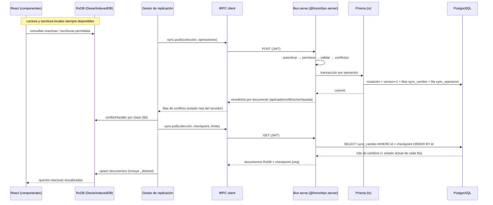

# RassaJala — Estrategia de sincronización

**Estado:** Consolidado con `docs/database.md` (§6 y §7 — entrada normativa de este documento), `docs/architecture.md` (§2, §6, §7), `docs/scope.md` (§3.1 y §7.1) y la auditoría (`docs/01-audit/audit-findings.md` §6, F-13/F-14, `frontend-audit.md` §6). Los contratos de RxDB fueron **verificados contra la documentación vigente de RxDB vía context7 (16/11/2026)**: las firmas e import paths citados en §2.1 son los que el corte vertical implementará tal cual. Lo no verificable se marca **VERIFICAR EN IMPLEMENTACIÓN**.

## 1. Objetivo

Permitir que RassaJala opere con y sin conexión, manteniendo la información local disponible y sincronizando los cambios permitidos con PostgreSQL.

Este documento define el protocolo de sincronización **concreto e implementable** del corte vertical: endpoints, esquemas de entrada/salida, semántica de checkpoints, resolución de conflictos, idempotencia, eliminaciones y reconexión. La clasificación de colecciones y las transformaciones documento↔fila provienen de `docs/database.md` §6; este documento no las redefine.

## 2. Tecnologías

| Componente        | Tecnología                                     | Import / ruta exacta                                     |
| ----------------- | ---------------------------------------------- | -------------------------------------------------------- |
| Base local        | RxDB                                           | `createRxDatabase` (`rxdb/plugins/core`)                 |
| Storage local     | Dexie sobre IndexedDB (gratuito, Apache-2.0)   | `getRxStorageDexie` desde `rxdb/plugins/storage-dexie`   |
| Replicación       | Protocolo de replicación de RxDB               | `replicateRxCollection` desde `rxdb/plugins/replication` |
| Transporte        | tRPC sobre `Bun.serve` con `@hono/trpc-server` | `apps/server`                                            |
| Acceso relacional | Prisma 7 + `@prisma/adapter-pg`                | `packages/db`                                            |
| Fuente de verdad  | PostgreSQL (Supabase)                          | —                                                        |

No utilizar PowerSync, ningún servicio externo de sincronización ni plugins premium de RxDB (`rxdb-premium/*` queda descartado; el storage "IndexedDB" premium no se usa — `docs/architecture.md` §2).

### 2.1 Contratos verificados de RxDB (context7, docs vigentes 16/11/2026)

Firmas exactas que implementará el corte vertical:

- `replicateRxCollection<RxDocType, CheckpointType>(options): RxReplicationState<RxDocType, CheckpointType>` — import desde `rxdb/plugins/replication`. Genérica sobre el tipo de documento **y sobre el tipo de checkpoint** del backend.
- Handler PULL — `ReplicationPullHandler<RxDocType, CheckpointType>`:
  `(lastPulledCheckpoint: CheckpointType | undefined, batchSize: number) => Promise<{ documents: WithDeleted<RxDocType>[], checkpoint: CheckpointType | undefined }>`.
  Si `documents.length < batchSize`, RxDB asume que no hay más cambios y pasa a modo observación.
- Handler PUSH — `ReplicationPushHandler<RxDocType>`:
  `(rows: RxReplicationWriteToMasterRow<RxDocType>[]) => Promise<WithDeleted<RxDocType>[]>`. Cada fila contiene `newDocumentState` y opcionalmente `assumedMasterState`. El valor de retorno es **solo** el array de documentos en conflicto (estado real del servidor); array vacío si no hubo conflictos. Los documentos devueltos disparan el `conflictHandler` de la colección.
- Opciones de `replicateRxCollection`: `collection`, `replicationIdentifier` (clave estable con la que RxDB persiste el checkpoint y **reanuda tras recarga**; se recomienda incluir la URL del servidor), `live` (default `true`), `retryTime` (default 5000 ms; **la espera se omite al detectar transición offline→online vía `navigator.onLine`**), `waitForLeadership` (default `true`; con múltiples pestañas solo la líder replica), `autoStart` (default `true`), `deletedField` (default `'_deleted'`; mapea un campo alternativo en la capa de datos), `push.batchSize`, `push.modifier`, `pull.batchSize`, `pull.modifier`, `pull.stream$` (opcional; **el corte vertical no lo implementa** — sin `stream$`, la detección de cambios del servidor se hace con `reSync()` periódico, patrón recomendado por la documentación para backends sin eventos).
- `RxReplicationState`: `reSync()` (fuerza un ciclo de iteración de checkpoints hasta quedar en sync), `cancel()` (cancela definitivamente; reiniciarla lanza `RC_START_CANCELED`; para reanudar se vuelve a llamar `replicateRxCollection` con el mismo `replicationIdentifier` y **reutiliza los checkpoints guardados**, sin redescargar todo), `pause()` (detención temporal del mismo estado), `start()`, observables `active$` y `error$`.
- `conflictHandler` (por colección, en `addCollections`): recibe `{ newDocumentState, realMasterState, … }` y retorna `{ documentData }`. **Solo se ejecuta durante la replicación** (cuando el servidor devuelve un estado maestro distinto al asumido), no ante escrituras locales puras.
- Requisitos de layout del lado servidor según la documentación: los documentos deben ser **ordenables de forma determinista por su última escritura** (clave primaria como segundo criterio del checkpoint) y las entidades replicadas **no deben borrarse físicamente**: se marca `_deleted: true`.
- Storage: `createRxDatabase({ name, storage: getRxStorageDexie() })`; acepta addons de Dexie.

## 3. Arquitectura

La comunicación sigue este flujo:

React → RxDB → tRPC → Bun → Prisma → PostgreSQL.

La replicación pasa siempre por el backend. El cliente nunca accede directamente a PostgreSQL/Supabase ni recibe credenciales administrativas (`docs/architecture.md` §7).

### 3.1 Inventario de componentes

| Componente                           | Ubicación                             | Responsabilidad                                                                                                                                                                                                              |
| ------------------------------------ | ------------------------------------- | ---------------------------------------------------------------------------------------------------------------------------------------------------------------------------------------------------------------------------- |
| Módulo de base local                 | `apps/web` — `src/db/`                | `createRxDatabase` con `getRxStorageDexie`; registro de colecciones con schemas y `conflictHandler` por clase (§6).                                                                                                          |
| Gestor de replicación                | `apps/web` — `src/sync/`              | Una función por colección que llama `replicateRxCollection` con handlers PULL/PUSH propios; encapsula el mapeo documento↔contrato tRPC.                                                                                      |
| Controlador de sincronización        | `apps/web` — `src/sync/controller.ts` | Arranca/detiene las replicaciones al iniciar sesión, cerrarla o cambiar de usuario (§11); expone `active$`/`error$` como indicadores de UI.                                                                                  |
| tRPC client                          | `apps/web`                            | Transporte autenticado (JWT) de los handlers.                                                                                                                                                                                |
| Router de sincronización             | `apps/server` — `syncRouter`          | Procedimientos `pull`/`push` por colección, generados por una fábrica común (`makePullProcedure(colección)` / `makePushProcedure(colección)`) con esquemas zod por colección. Valida sesión, permisos y ámbito por petición. |
| Registro de colecciones del servidor | `apps/server`                         | Mapa declarativo `colección → tablas, filtros de ámbito (database.md §6.2), reglas de validación`; única fuente del `syncRouter`.                                                                                            |
| Outbox transaccional                 | PostgreSQL — `sync_cambio`            | M-1a (`docs/database.md` §7.1): fila append-only escrita en la **misma transacción** que cada mutación de negocio. Fundamento del checkpoint PULL.                                                                           |
| Registro de idempotencia             | PostgreSQL — `sync_operacion`         | §7 de este documento: verdicto por operación PUSH, escrito transaccionalmente con el efecto.                                                                                                                                 |

### 3.2 Flujo (secuencia)

## 4. PULL

Flujo PostgreSQL → RxDB. Implementado con el `pull.handler` de `replicateRxCollection` llamando al procedimiento tRPC `sync.pull`.

### 4.1 Endpoint

- Procedimiento: `sync.pull` (uno por colección vía fábrica).
- Entrada (zod): `{ colección: string (blanca), checkpoint: { seq: number } | null, límite: number (5–200, default 50) }`.
- Salida: `{ documentos: DocRxDB[], checkpoint: { seq: number } }` — documentos ya transformados al formato RxDB (§6.3 de `docs/database.md`): camelCase, dinero como string, tiempos ISO 8601, `_deleted: boolean` explícito.

### 4.2 Checkpoint

- **El checkpoint es el último `sync_cambio.id` (bigserial) entregado**, por colección. Tipo de checkpoint de RxDB: `{ seq: number }`. (Prisma devuelve `BigInt`: el endpoint serializa `seq` como `number` — escala del proyecto muy por debajo de `2^53`; convertir con `Number()` y validar `< Number.MAX_SAFE_INTEGER`.)
- **Por qué no basta `updated_at`:** en PostgreSQL `now()` fija la marca al **inicio** de la transacción; dos transacciones concurrentes pueden asignar `actualizado_en` en un orden distinto al de su commit. Un cliente que avanza el cursor por timestamp puede saltarse una fila cuyo `actualizado_en` es anterior al checkpoint pero que committeó después → cambio perdido. El `bigserial` de `sync_cambio` provee un orden total determinista asignado en la misma transacción que el cambio (M-1a).
- **Ventana de brecha (gap window):** un `bigserial` se asigna al INSERT, no al commit: T1 puede obtener `seq=10`, T2 `seq=11` y committear T2 antes. Si el PULL entrega `11` mientras `10` sigue en vuelo y avanza el checkpoint, se pierde el cambio de T1. Regla obligatoria del endpoint PULL: **solo avanzar el checkpoint sobre prefijos contiguos de `seq`**; ante una brecha entre filas entregadas, cortar el lote en la brecha salvo que la brecha sea más vieja que la ventana de gracia (default 60 s, mayor que toda transacción de negocio), en cuyo caso se asume secuencia consumida por una transacción revertida (los reintentos de secuencia no se recuperan) y se omite. Justificación del límite inferior de edad: la asignación de `nextval` es estrictamente creciente en el tiempo, y `creado_en` de la primera fila posterior a la brecha es posterior a la asignación de la secuencia faltante → esa marca acota por abajo la edad de la brecha. Al cortar un lote en una brecha joven, el lote queda corto (< `límite`): RxDB pasa a modo observación y el `reSync()` periódico (§10) reintenta hasta cerrar la brecha — sin riesgo de estancamiento.
- Reintentos fallidos: si el pull falla (red), RxDB reintenta con el **mismo** `lastCheckpoint` — el checkpoint solo avanza con respuesta exitosa aplicada.

### 4.3 Orden, paginación y reanudación

- Consulta servidor: `SELECT * FROM sync_cambio WHERE id > :seq AND tabla_origen IN (:tablas_de_la_colección) ORDER BY id ASC LIMIT :límite + N` (`N` margen para evaluar brechas), sobre una única consulta (snapshot consistente).
- Por cada fila de outbox se resuelve el **estado actual** de la fila de negocio (`id_fila`); `operacion='delete'` o fila inexistente → documento con `_deleted: true`. Optimización permitida: coalescer dentro del lote por `id_fila` conservando el mayor `seq`.
- Paginación: lotes de `límite` documentos; el cliente devuelve el `checkpoint` del último documento del lote. Reanudación tras recarga: `replicationIdentifier` (incluye URL del servidor y usuario, §11) recupera el checkpoint persistido por RxDB — sin redescargar.

### 4.4 Scoping por colección y sincronización inicial

- El filtro de ámbito por rol/familia de `docs/database.md` §6.2 se aplica en el servidor **sobre las filas resueltas**; las filas filtradas fuera igual avanzan el checkpoint (son invisibles para ese usuario).
- Sincronización inicial: `checkpoint = null` → el servidor entrega desde `seq = 0` (colecciones S1 pequeñas: volcado completo; `estados_pedido`/`tipos_pago` no tienen soft-delete y se entregan íntegras).
- Sincronización incremental: todo pull posterior con el último checkpoint.
- Cambios de ámbito (membresía/rol que amplían datos visibles): requieren un re-pull completo desde `null` (upsert no destructivo) disparado por RESYNC; fuera del alcance del corte vertical (nota de diseño).

## 5. PUSH

Flujo RxDB → PostgreSQL. Implementado con el `push.handler` llamando al procedimiento tRPC `sync.push`. Solo las colecciones con "Escritura offline: Sí" en `docs/database.md` §6.2 registran handler PUSH; las colecciones S1 de solo lectura se replican **solo PULL** (el push es opcional en `replicateRxCollection`).

### 5.1 Endpoint

- Procedimiento: `sync.push`.
- Entrada (zod): `{ colección: string (blanca), operaciones: OperacionPush[] }` con:
  - `operationId: uuid` — id de operación generado por el cliente, estable entre reintentos (§7).
  - `docId: string` — id de documento (PK string; P-1 de `docs/database.md` §5.3 bajo su default mínimo).
  - `op: 'create' | 'update' | 'delete'` — derivado en el cliente de la fila de push: `_deleted: true` → `delete`; `assumedMasterState` presente → `update`; ausente → `create`.
  - `nuevoEstado` — `newDocumentState` tal cual (incluye `_deleted`).
  - `versionAsumida: number | null` — `assumedMasterState?.version` si existe.
- Salida: `{ resultados: [{ operationId, docId, veredicto: 'aplicada' | 'conflicto' | 'rechazada', motivo?, estadoServidor? }] }`.
- Mapeo de vuelta a RxDB: el `push.handler` retorna **únicamente** los documentos `estadoServidor` de veredictos `conflicto` y `rechazada` (contrato verificado: el retorno del handler es el array de conflictos). Para `rechazada` sobre un `create` sin fila servidor, el servidor sintetiza como `estadoServidor` un **tombstone** (`{ …nuevoEstado, _deleted: true }`) para que el `conflictHandler` server-wins elimine el documento local y no quede un fantasma "sincronizado". Los motivos de `rechazada` se publican además a un subject de UI para indicadores visibles.

### 5.2 Pasos del servidor (por operación; transacción Prisma por operación)

1. **Autenticar** (JWT en el contexto tRPC) y resolver rol/usuario.
2. **Idempotencia:** buscar `sync_operacion` por `operationId`; si existe, devolver su veredicto almacenado sin re-ejecutar (§7). Carrera entre dos pushes concurrentes del mismo `operationId`: resuelta por PK de `sync_operacion` (violación UNIQUE → leer el veredicto existente).
3. **Permisos y reglas de dominio** de la colección (ámbito por rol; reglas por módulo de `docs/database.md` §6.2 — stock, crédito, estados, ventanas).
4. **Comprobación de versiones (detección de conflictos):** cada tabla sincronizable lleva columna `version integer NOT NULL DEFAULT 1` (requisito de protocolo **SP-2**, complemento de M-1a/M-1b; incrementada en la misma transacción que la mutación). El servidor compara contra `versionAsumida`:
   - `create`: la fila no debe existir; si existe, no es replay idempotente (paso 2 falló a encontrarlo) → `conflicto` con estado real.
   - `update`/`delete`: la fila debe existir y `version == versionAsumida`; si difiere → `conflicto`, retornando el estado real del servidor.
   - El servidor **no** confía en `_rev` ni en timestamps del cliente: la única señal de conflicto es la `version` servidor.
5. **Aplicar** la mutación vía Prisma y escribir **en la misma transacción**: la mutación (`version + 1`), las filas `sync_cambio` de cada tabla tocada (outbox M-1a) y la fila `sync_operacion` con el veredicto (§7).
6. **Veredicto por documento:** `aplicada` (sin estado de retorno: el estado normalizado llega después por PULL, ya que el outbox de la propia escritura lo entrega), `conflicto` (con `estadoServidor`), `rechazada` (con `motivo` y `estadoServidor`, preservando ambos estados en `sync_operacion` para revisión, §6).

Nota: las primitivas de concurrencia PostgreSQL (advisory locks para folios, `SELECT … FOR UPDATE` ordenado) siguen siendo responsabilidad del código servidor vía `prisma.$executeRaw`/`$queryRaw` (F-07); este protocolo no las sustituye. En el corte vertical no se requieren: la única escritura demostrada no genera folios y la carrera de idempotencia se resuelve por PK (§14).

## 6. Estrategia de conflictos

No aplicar Last Write Wins globalmente. El `conflictHandler` (contrato verificado §2.1) se define **por colección** según su clase de `docs/database.md` §6:

| Clase                | Colecciones (clase de database.md §6)                                                        | Política de conflicto                                                                                                                                                                                                                                      | `conflictHandler`                                                                                                                                  |
| -------------------- | -------------------------------------------------------------------------------------------- | ---------------------------------------------------------------------------------------------------------------------------------------------------------------------------------------------------------------------------------------------------------- | -------------------------------------------------------------------------------------------------------------------------------------------------- |
| S1 — catálogos       | `municipios`, `localidades`, `categorias`, `unidades`, `roles`, `usuarios`, `familias`, etc. | Prevalece la información central. Sin push de cliente en producción (§5).                                                                                                                                                                                  | `(i) => ({ documentData: i.realMasterState })` — server-wins incondicional.                                                                        |
| S2 — transaccional   | `pedidos`, `pagos`, `mermas`, `recoleccion`, `cortes`, `liquidaciones`, `publicaciones`      | El servidor es autoritativo: valida stock/crédito/estados y adjudica (folios, unicidad de slot, recálculos). El dinero y el inventario **no** se escriben como documento crudo: se aplican como operaciones validadas (§9, carril de confirmación online). | Server-wins: el cliente adopta `realMasterState`; el estado local rechazado queda preservado en `sync_operacion` (ambos estados) para revisión.    |
| S3 — eventual (chat) | `conversaciones`, `mensajes`                                                                 | Bidireccional de alta frecuencia; superficie de conflicto: `leido`, `editado`, ventana de 15 min. Resolución por reglas de dominio en el servidor; los conflictos no auto-resolubles se conservan.                                                         | Fusión mínima: campos server-owned (`leido`) toman `realMasterState`; el resto se resuelve server-side; artefacto de revisión en `sync_operacion`. |
| Perfil               | `usuarios` (campos propios)                                                                  | Validación del servidor; edición online (S4 en database.md §6.2).                                                                                                                                                                                          | No aplica (sin push local).                                                                                                                        |

- Los conflictos que no puedan resolverse automáticamente **conservan ambos estados** (`nuevoEstado` del cliente, `estadoServidor` real) en la fila `sync_operacion` correspondiente: nada se descarta sin rastro.
- Ningún conflicto se resuelve comparando timestamps de cliente (misma razón que §4.2).

## 7. Idempotencia

Las operaciones PUSH deben soportar reintentos. La repetición de una solicitud no genera pedidos, pagos, movimientos de stock, transiciones ni liquidaciones duplicados.

- **Tabla `sync_operacion`** (requisito de protocolo **SP-3**): `id uuid PK` (= `operationId` del cliente), `fk_usuario`, `coleccion`, `doc_id`, `op`, `veredicto` (`aplicada|conflicto|rechazada`), `respuesta jsonb` (estado normalizado servidor o motivo, con `nuevoEstado` y `estadoServidor` cuando aplica — artefacto de revisión de §6), `creado_en`. Escrita en la **misma transacción** que el efecto (patrón idéntico al outbox M-1a).
- **`operationId`:** UUID generado por el cliente por cada mutación local y **estable entre reintentos**. Diseño normativo: campo de schema `sync_op_id` en toda colección con push; la ruta de escritura local lo asigna y lo deja invariable (un reintento re-envía el mismo `newDocumentState`, luego el mismo id). Alternativa (si se confirma que `_rev` viaja en las filas de push — **VERIFICAR EN IMPLEMENTACIÓN**): derivarlo determinísticamente de `(docId, _rev)` sin campo extra.
- **Semántica de reintento:** mismo `operationId` → veredicto almacenado, sin re-ejecutar efectos. Aplica tanto al push de replicación como a **toda mutación tRPC de confirmación online** con efecto financiero o de estado (§9): el cliente envía `operationId` en ambas rutas.
- **Corrige F-13/F-14:** el `Idempotency-Key` del sistema original viajaba por header y nunca fue leído por el backend (F-13); toda la maquinaria client-side de checkout (marcadores ambiguos, reconciliación por total+productos, llaves acumuladas sin limpieza — F-14, `frontend-audit.md` §6) se sustituye por idempotencia **server-side transaccional**. La maquinaria legacy es insumo de requisitos, no código a portar.

## 8. Eliminaciones

Utilizar tombstones para propagar eliminaciones; distinguir la eliminación técnica de replicación de la de negocio.

| Caso                                                                               | Servidor                                                                                                                     | RxDB                                                                                                                     |
| ---------------------------------------------------------------------------------- | ---------------------------------------------------------------------------------------------------------------------------- | ------------------------------------------------------------------------------------------------------------------------ |
| Soft-delete de catálogo (`estado=false`) en tablas con boolean                     | fila conservada; outbox `operacion='update'`; transform emite `_deleted: true` **conservando `estado`** (database.md §6.3.5) | documento con `_deleted: true`; trash/restore posterior llega como actualización normal (`_deleted: false`)              |
| Lifecycle varchar (`publicacion_semanal`, `recoleccion`, `corte`, `liquidacion`)   | el cambio de `estado` es una actualización normal; **nunca** `_deleted` (database.md §6.2)                                   | actualización normal sincronizada                                                                                        |
| Hard delete (`eliminar-permanente` de catálogos/familias, membresías físicas)      | evento server-owned; outbox `operacion='delete'`                                                                             | `_deleted: true` push-down; el cliente nunca decide borrados físicos                                                     |
| Borrado lógico de negocio con push (p. ej. mensaje dentro de la ventana de 15 min) | validación server de la ventana; soft-delete + outbox                                                                        | `newDocumentState._deleted = true` en la fila de push (opción `deletedField` no se usa: el servidor ya emite `_deleted`) |

- La propagación de tombstones viaja por el outbox como cualquier cambio (§4): orden determinista, sin canal aparte.
- No eliminar físicamente información con historial o integridad asociada (FKs PROTECT — database.md §4.5).

## 9. Clasificación de operaciones

Tres carriles concretos, alineados con `docs/database.md` §6.2 (columna "Escritura offline") y los módulos de `docs/scope.md` §3.1:

| Módulo                                                                                             | Colección                           | Carril                                                                                            | Canal                                                                |
| -------------------------------------------------------------------------------------------------- | ----------------------------------- | ------------------------------------------------------------------------------------------------- | -------------------------------------------------------------------- |
| Catálogos (municipios, localidades, categorías, unidades, tipos de pago, estados, roles, familias) | S1                                  | Solo lectura offline (cache-first)                                                                | PULL                                                                 |
| Perfil y documentos                                                                                | `usuarios` (propio)                 | Confirmación online                                                                               | mutación tRPC + `operationId`                                        |
| Publicaciones semanales                                                                            | `publicaciones`                     | Lectura offline; borrador local condicionado (Pu1/Pu4) — validación server al publicar            | PULL; push de borrador: decisión futura (fuera del corte vertical)   |
| Pedidos                                                                                            | `pedidos`                           | Escritura offline en cola (creación); stock/crédito/estado validados y adjudicados en el servidor | push de replicación (creación) + mutaciones online para transiciones |
| Pagos y recibos                                                                                    | `pagos`, `recibos`                  | Confirmación online exclusivamente (folio, invariantes server-side)                               | mutación tRPC + `operationId`                                        |
| Recolecciones                                                                                      | `recoleccion`                       | Confirmación online (unicidad de slot adjudicada en servidor)                                     | mutación tRPC + `operationId`                                        |
| Cortes, liquidaciones, mermas                                                                      | `cortes`, `liquidaciones`, `mermas` | Confirmación online / server-owned                                                                | mutación tRPC + `operationId`                                        |
| Chat                                                                                               | `conversaciones`, `mensajes`        | Escritura offline en cola (S3 eventual)                                                           | push de replicación bidireccional                                    |
| Imágenes (binarios)                                                                                | `producto_imagenes`, `documento`    | Subida solo-online (D-1); referencias por PULL                                                    | mutación tRPC para subida; PULL para referencias                     |
| Logs, auth, tokens                                                                                 | —                                   | Solo-online, **nunca en cliente** (S4)                                                            | sin colección RxDB                                                   |

- **Lectura offline:** información previamente sincronizada y permitida por los permisos del usuario.
- **Escritura offline (cola):** solo operaciones cuyo impacto puede gestionarse de manera segura con cola local + validación central al sincronizar (borradores, mensajes, creación de pedidos).
- **Confirmación online:** pagos, transiciones de pedidos, movimientos de inventario, liquidaciones, cortes, operaciones financieras — nunca viajan como documento crudo por el push de replicación.

Esta clasificación se ajustará a las reglas reales del negocio conforme se cierren Q-19/Q-29 (escritura de `producto`/catálogos, D-9).

## 10. Reconexión

La sincronización se reanuda sin intervención manual:

- **Al iniciar la aplicación:** `autoStart: true` (default verificado) — cada replicación arranca con su `replicationIdentifier` y retoma el checkpoint persistido.
- **Al recuperar conectividad:** `retryTime` (default 5000 ms verificado) espera el reintento de una petición fallida, **y la espera se omite al detectar transición offline→online vía `navigator.onLine`** — comportamiento nativo del protocolo de replicación, no código propio.
- **Al recuperar el foco y periódicamente:** al no implementarse `pull.stream$` (sin SSE/WebSockets en el corte vertical), el controlador programa `reSync()` en un intervalo (patrón recomendado por la documentación de RxDB para backends sin eventos) y lo dispara además en `window` `focus`/`online`. No se depende de Background Sync (§2); el service worker de PWA solo cachea assets.
- **Errores recuperables** (red, 5xx): reintento por `retryTime`; el checkpoint solo avanza con éxito.
- **Errores permanentes (4xx):** sin reintentos infinitos. El handler distingue el error; el controlador actúa según tipo: `401/403` → detener replicaciones (`pause()` en sesión aún válida; `cancel()` + recreación con el mismo `replicationIdentifier` reutilizando checkpoints en logout/cambio de usuario — semántica verificada §2.1) y solicitar re-autenticación; validación rechazada → veredicto `rechazada` del push (§5), que ya no se reintenta. `error$` alimenta los indicadores de UI.

## 11. Aislamiento de usuarios

- **Replicaciones por identidad autenticada:** se crean tras el login y su `replicationIdentifier` incluye el id de usuario y la URL del servidor (`sync:<colección>:<usuario>@<servidor>`) — la clave de reanudación de checkpoints queda aislada por cuenta; no hay mezcla de checkpoints entre usuarios.
- **Filtros en cada operación:** autenticación, rol y ámbito (database.md §6.2) se revalidan en cada `pull`/`push` (principio 7 de `docs/architecture.md`); la colección local solo contiene lo que el scoping permite.
- **Cierre de sesión:** el controlador detiene todas las replicaciones (`pause()` si la sesión va a retomarse; `cancel()` + recreación posterior al login, que reutiliza los checkpoints por `replicationIdentifier`).
- **Cambio de usuario — política de limpieza local (mínima):** al iniciar sesión con un usuario distinto al último activo, se purgan localmente los documentos **no-tombstone** de las colecciones replicadas antes de arrancar las replicaciones nuevas. Tradeoff aceptado: se pierde cualquier dato local aún no confirmado del usuario anterior (drafts, mensajes en cola); la alternativa (una base RxDB con nombre distinto por usuario, sin purga) se posterga por ser infraestructura adicional. `estados_pedido`/`tipos_pago` (catálogos globales sin dato sensible) pueden conservarse.

## 12. Pruebas obligatorias

Cada prueba del listado original, con su resultado observable verificable en el corte vertical:

| Prueba                              | Comprobación observable                                                                                                                                                                                                                                                                               |
| ----------------------------------- | ----------------------------------------------------------------------------------------------------------------------------------------------------------------------------------------------------------------------------------------------------------------------------------------------------- |
| Persistencia offline                | Con el servidor detenido, escribir un documento permitido, recargar la página (Dexie/IndexedDB persiste) y leerlo: la query reactiva devuelve el documento sin conexión.                                                                                                                              |
| Reconexión                          | Reanudar el servidor: dentro de `retryTime`/evento `online` el push se entrega; el documento aparece en PostgreSQL y el indicador de sync pasa a activo.                                                                                                                                              |
| Recuperación de checkpoints         | Sembrar en `sync_cambio` más filas que el `límite`; la sincronización inicial entrega todos por lotes; recargar el navegador a mitad de sincronización: el siguiente `sync.pull` llega con el checkpoint del último lote (el servidor registra el `seq` solicitado) y no re-entrega filas anteriores. |
| Reintentos                          | Inyectar un 500 una vez en `sync.push`: el mismo `operationId` se reintenta y la operación se aplica exactamente una vez.                                                                                                                                                                             |
| Idempotencia                        | Enviar el mismo push dos veces: la segunda respuesta devuelve el veredicto almacenado; `count(*)` en la tabla de negocio no cambia; una fila en `sync_operacion`.                                                                                                                                     |
| Conflictos concurrentes             | Dos clientes actualizan la misma `localidad` con la misma `versionAsumida`: el segundo recibe `conflicto` con `estadoServidor`; tras sincronizar, el documento del perdedor es igual al estado del servidor; `sync_operacion` conserva ambos estados.                                                 |
| Eliminaciones                       | Soft-delete de un `municipio` en el servidor → el cliente lo recibe con `_deleted: true` (findOne null); restaurarlo llega como actualización normal.                                                                                                                                                 |
| Cambio de usuario                   | Logout detiene replicaciones; login como otro usuario: las colecciones locales están vacías antes del primer pull (política de purga §11).                                                                                                                                                            |
| Desconexiones prolongadas           | 5 minutos offline con N escrituras permitidas en cola: al reconectar, las N llegan en orden de checkpoint y `count(*)` en PostgreSQL coincide; ninguna se pierde ni duplica.                                                                                                                          |
| Recuperación tras respuesta perdida | Aceptar el push en el servidor y descartar la respuesta (proxy): el reintento con el mismo `operationId` devuelve el veredicto almacenado; una sola fila en PostgreSQL y estado cliente correcto.                                                                                                     |
| Consistencia PostgreSQL ↔ RxDB      | Tras sincronizar, para cada colección del slice: `count` y checksum de campos clave idénticos en ambos lados.                                                                                                                                                                                         |

## 13. Criterio de aceptación

- No se considera sincronizado un cambio hasta contar con confirmación del servidor cuando la operación requiera confirmación central (veredicto `aplicada` del push o respuesta de la mutación online).
- La sincronización demuestra que no pierde operaciones confirmadas, no duplica efectos y respeta reglas de negocio y permisos.
- La implementación utiliza las interfaces reales de replicación de RxDB (`replicateRxCollection` con handlers PULL/PUSH, checkpoint por `replicationIdentifier`, `conflictHandler` por colección) según los contratos verificados en §2.1.
- Los nueve puntos de `docs/scope.md` §7.1 quedan demostrados con las colecciones del §14.

## 14. Alcance del vertical slice

Designación exacta de colecciones del corte vertical (todas existen en `docs/database.md` §6.2):

- **PULL (solo lectura, S1 cache-first):** `municipios`, `localidades`, `categorias`, `unidades` — catálogos geográficos y de producto, de alta lectura y baja escritura (audit-findings §6). Opcional e incluida sin costo: `estados_pedido` y `tipos_pago` (tablas de semilla pequeñas, PULL completo sin soft-delete).
- **PUSH (demostración del mecanismo):** **`localidades`** con rol admin: creación y actualización de filas reales del catálogo + soft-delete/tombstone (trash/restore propagable). Elección y justificación: (1) es una entidad real y de bajo riesgo — sin datos financieros, sin folios, sin stock, sin límites de crédito; (2) ejercita el ciclo completo del protocolo: create, update, conflicto por `version`, tombstone por soft-delete y restore; (3) su CRUD admin es un módulo P0 real (`docs/scope.md` §3.1, "Catálogos — COMPLETAR"), no un invento. La escritura offline admin sobre `localidades` es una **excepción de demostración del mecanismo** claramente acotada: la clasificación productiva de database.md §6.2 (S1 sin escritura offline para usuarios normales) no se modifica; el corte valida la maquinaria que reutilizarán las colecciones S2/S3. La alternativa real con escritura offline nativa (chat S3 — `mensajes`) se descarta para el slice porque arrastra `conversaciones`/`integrantes`/`documento` y su superficie de conflictos: más alcance, misma validación de mecanismo.
- **Requisitos de esquema que el slice necesita:** `sync_cambio` (M-1a), `actualizado_en` (M-1b; el backfill D-7 no aplica: la base destino está vacía), `version` (SP-2, §5.2), `sync_operacion` (SP-3, §7).
- **Dependencias de decisiones pendientes (no se deciden aquí):**
  - **D-2 / M-3 (UUID vs Int+uuid paralelo):** bajo el default mínimo (P-1: PK UUID string) el `docId` es la PK; si se elige la alternativa, solo cambia la resolución servidor `uuid → id` — el protocolo es transparente a la elección.
  - **D-9 (escritura de `producto`, Q-19):** no afecta al slice (`productos` fuera de alcance); condiciona el scoping/permisos de PULL/PUSH de esa colección en fases siguientes.
  - **D-3 (IVA), Q-14 (redondeo), F-05/F-07:** bloquean módulos de dinero, no este protocolo; las invariantes financieras se validan server-side cuando esos módulos se construyan.
- **Primitivas de concurrencia PostgreSQL** (advisory locks para folios, `SELECT … FOR UPDATE` ordenado vía `prisma.$executeRaw`, F-07): permanecen como responsabilidad del código servidor en módulos futuros; el slice no las ejercita (§5.2 nota).
- **Fuera del alcance del slice:** pagos, pedidos, stock, crédito, chat, publicaciones, liquidaciones, cortes, mermas, recolecciones, `stream$` (SSE/WebSockets), limpieza de tombstones antiguos.
